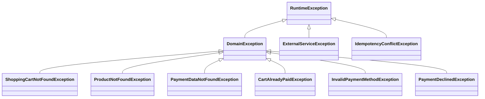

# Error Handling Specification

**Status**: Confirmed  
**Version**: 1.0  
**Last Updated**: 2026-11-23  
**Owner**: Business Analyst / Technical Analyst

---

## 1. Overview

This document defines the standardized error handling approach for the Checkout BFF. All API errors follow a consistent contract to enable predictable frontend error display. The error contract is defined in the [API Contracts](../technical/api-contracts.md#24-error-responses).

---

## 2. Frontend Error Contract

All error responses must conform to this structure (per API Contracts):

```json
{
  "displayType": "BLOCK|INTERVENTION",
  "errorCode": "string",
  "cartId": "uuid",  // not required for pre-checkout
  "frontendError": {
    "code": "string",
    "title": "string",
    "description": "string",
    "primaryButton": {
      "label": "string",
      "url": "string"
    },
    "secondaryButton": {  // optional
      "label": "string",
      "url": "string"
    }
  }
}
```

### 2.1 Field Definitions

| Field | Required | Type | Description |
|-------|----------|------|-------------|
| `displayType` | Yes | Enum | `BLOCK` or `INTERVENTION` - Defines how frontend displays error |
| `errorCode` | Yes | String | Unique identifier for the checkout error |
| `cartId` | Conditional | UUID | Cart identifier (required for checkout errors, not for pre-checkout) |
| `frontendError.code` | Yes | String | Frontend-specific error identifier |
| `frontendError.title` | Yes | String | Error title displayed to customer |
| `frontendError.description` | Yes | String | Detailed error message displayed to customer |
| `frontendError.primaryButton.label` | Yes | String | Primary action button label |
| `frontendError.primaryButton.url` | Yes | String | Action identifier or navigation URL |
| `frontendError.secondaryButton` | No | Object | Alternative action button |

### 2.2 Display Types

| Type | Description | Use Case |
|------|-------------|----------|
| `BLOCK` | Error that interrupts flow, requires user action | Validation errors, payment failures |
| `INTERVENTION` | Warning that doesn't terminate flow | Upsell, recommendation, soft decline |

### 2.3 Primary Button Actions

| URL Value | Behavior |
|-----------|----------|
| `RETRY` | Retry the same operation |
| `/` | Navigate to home |
| `/checkout/pagamento` | Navigate to payment selection |

---

## 3. Error Codes Catalog

### 3.1 Pre-Checkout Errors

| Error Code | HTTP Status | Frontend Code | Title | Description | Primary Button |
|------------|-------------|---------------|-------|-------------|----------------|
| `INVALID_REQUEST` | 400 | P-1007 | Carrinho Inválido | Pelo menos um produto é necessário. | RETRY |
| `PRODUCT_NOT_FOUND` | 400/422 | P-1004 | Produto não encontrado | Os seguintes produtos não foram encontrados: {slugs} | Retornar (/) |
| `PRODUCT_UNAVAILABLE` | 400/422 | P-1005 | Produto indisponível | Os seguintes não estão disponíveis: {slugs} | Retornar (/) |
| `SERVICE_UNAVAILABLE` | 503 | P-9999 | Serviço de pagamento indisponível | Não foi possível concluir o pagamento, tente novamente mais tarde. | RETRY |
| `INTERNAL_ERROR` | 500 | P-9998 | Erro interno inesperado | Um erro inesperado aconteceu, tente novamente mais tarde. | RETRY |

### 3.2 Checkout Errors (Sync & Async)

| Error Code | HTTP Status | Frontend Code | Title | Description | Primary Button | Secondary Button |
|------------|-------------|---------------|-------|-------------|----------------|------------------|
| `PAYMENT_DECLINED` | 402 | P-1001 | Pagamento não aprovado | Não foi possível concluir o pagamento. Tente novamente ou escolha outro meio. | RETRY | Trocar meio de pagamento (/checkout/pagamento) |
| `INVALID_CART` | 404 | P-1000 | Carrinho inválido | Carrinho não encontrado. | RETRY | Trocar meio de pagamento (/checkout/pagamento) |
| `ALREADY_PAID` | 409 | P-1002 | Carrinho já pago | Não foi possível concluir o pagamento: carrinho já foi previamente pago. | Voltar (/) | - |
| `INVALID_PAYMENT_DETAILS` | 400/422 | P-1001 | Método de pagamento inválido | Erro validando o método de pagamento, tente novamente com outro método. | RETRY | Trocar meio de pagamento (/checkout/pagamento) |
| `SERVICE_UNAVAILABLE` | 503 | P-9999 | Serviço de pagamento indisponível | Não foi possível concluir o pagamento, tente novamente mais tarde. | RETRY | Voltar (/) |
| `INTERNAL_ERROR` | 500 | P-9999 | Erro interno inesperado | Um erro inesperado aconteceu, tente novamente mais tarde. | RETRY | Voltar (/) |

### 3.3 Cart Status Verification Errors

| Error Code | HTTP Status | Frontend Code | Title | Description |
|------------|-------------|---------------|-------|-------------|
| `PAYMENT_DECLINED` | 402 | P-1001 | Pagamento não aprovado | Não foi possível concluir o pagamento. Tente novamente ou escolha outro meio. |
| `INVALID_CART` | 404 | P-1000 | Carrinho inválido | Carrinho não encontrado. |
| `SERVICE_UNAVAILABLE` | 503 | P-9999 | Serviço de pagamento indisponível | Não foi possível concluir o pagamento, tente novamente mais tarde. |
| `INTERNAL_ERROR` | 500 | P-9999 | Erro interno inesperado | Um erro inesperado aconteceu, tente novamente mais tarde. |

---

## 4. Error Response Examples

### 4.1 Pre-Checkout: Validation Error (400)

```json
{
  "displayType": "BLOCK",
  "errorCode": "INVALID_REQUEST",
  "frontendError": {
    "code": "P-1007",
    "title": "Carrinho Inválido",
    "description": "Pelo menos um produto é necessário.",
    "primaryButton": {
      "label": "Tentar novamente",
      "url": "RETRY"
    }
  }
}
```

### 4.2 Pre-Checkout: Product Not Found (400)

```json
{
  "displayType": "BLOCK",
  "errorCode": "PRODUCT_NOT_FOUND",
  "frontendError": {
    "code": "P-1004",
    "title": "Produto não encontrado",
    "description": "Os seguintes produtos não foram encontrados: slug-inválida, slug-inválida2",
    "primaryButton": {
      "label": "Retornar",
      "url": "/"
    }
  }
}
```

### 4.3 Pre-Checkout: Product Unavailable (400)

```json
{
  "displayType": "BLOCK",
  "errorCode": "PRODUCT_UNAVAILABLE",
  "frontendError": {
    "code": "P-1005",
    "title": "Produto indisponível",
    "description": "Os seguintes não estão disponíveis: slug-inválida1, slug-inválida2",
    "primaryButton": {
      "label": "Retornar",
      "url": "/"
    }
  }
}
```

### 4.4 Pre-Checkout: Service Unavailable (503)

```json
{
  "displayType": "BLOCK",
  "errorCode": "SERVICE_UNAVAILABLE",
  "frontendError": {
    "code": "P-9999",
    "title": "Serviço de pagamento indisponível",
    "description": "Não foi possível concluir o pagamento, tente novamente mais tarde.",
    "primaryButton": {
      "label": "Tentar novamente",
      "url": "RETRY"
    },
    "secondaryButton": {
      "label": "Voltar",
      "url": "/"
    }
  }
}
```

### 4.5 Checkout: Payment Declined (402)

```json
{
  "displayType": "BLOCK",
  "errorCode": "PAYMENT_DECLINED",
  "cartId": "550e8400-e29b-41d4-a716-446655440000",
  "frontendError": {
    "code": "P-1001",
    "title": "Pagamento não aprovado",
    "description": "Não foi possível concluir o pagamento. Tente novamente ou escolha outro meio.",
    "primaryButton": {
      "label": "Tentar novamente",
      "url": "RETRY"
    },
    "secondaryButton": {
      "label": "Trocar meio de pagamento",
      "url": "/checkout/pagamento"
    }
  }
}
```

### 4.6 Checkout: Cart Not Found (404)

```json
{
  "displayType": "BLOCK",
  "errorCode": "INVALID_CART",
  "cartId": "550e8400-e29b-41d4-a716-446655440000",
  "frontendError": {
    "code": "P-1000",
    "title": "Carrinho inválido",
    "description": "Carrinho não encontrado.",
    "primaryButton": {
      "label": "Tentar novamente",
      "url": "RETRY"
    },
    "secondaryButton": {
      "label": "Trocar meio de pagamento",
      "url": "/checkout/pagamento"
    }
  }
}
```

### 4.7 Checkout: Already Paid (409)

```json
{
  "displayType": "BLOCK",
  "errorCode": "ALREADY_PAID",
  "cartId": "550e8400-e29b-41d4-a716-446655440000",
  "frontendError": {
    "code": "P-1002",
    "title": "Carrinho já pago",
    "description": "Não foi possível concluir o pagamento: carrinho já foi previamente pago.",
    "primaryButton": {
      "label": "Voltar",
      "url": "/"
    }
  }
}
```

### 4.8 Checkout: Invalid Payment Details (400/422)

```json
{
  "displayType": "BLOCK",
  "errorCode": "INVALID_PAYMENT_DETAILS",
  "cartId": "550e8400-e29b-41d4-a716-446655440000",
  "frontendError": {
    "code": "P-1001",
    "title": "Método de pagamento inválido",
    "description": "Erro validando o método de pagamento, tente novamente com outro método.",
    "primaryButton": {
      "label": "Tentar novamente",
      "url": "RETRY"
    },
    "secondaryButton": {
      "label": "Trocar meio de pagamento",
      "url": "/checkout/pagamento"
    }
  }
}
```

### 4.9 Checkout: Service Unavailable (503)

```json
{
  "displayType": "BLOCK",
  "errorCode": "SERVICE_UNAVAILABLE",
  "cartId": "550e8400-e29b-41d4-a716-446655440000",
  "frontendError": {
    "code": "P-9999",
    "title": "Serviço de pagamento indisponível",
    "description": "Não foi possível concluir o pagamento, tente novamente mais tarde.",
    "primaryButton": {
      "label": "Tentar novamente",
      "url": "RETRY"
    },
    "secondaryButton": {
      "label": "Voltar",
      "url": "/"
    }
  }
}
```

### 4.10 Checkout: Internal Error (500)

```json
{
  "displayType": "BLOCK",
  "errorCode": "INTERNAL_ERROR",
  "cartId": "550e8400-e29b-41d4-a716-446655440000",
  "frontendError": {
    "code": "P-9998",
    "title": "Erro interno inesperado",
    "description": "Um erro inesperado aconteceu, tente novamente mais tarde.",
    "primaryButton": {
      "label": "Tentar novamente",
      "url": "RETRY"
    },
    "secondaryButton": {
      "label": "Voltar",
      "url": "/"
    }
  }
}
```

---

## 5. Exception Handling Architecture

### 5.1 Exception Hierarchy



### 5.2 Domain Exceptions

```java
// Base domain exception
public class DomainException extends RuntimeException {
    private final String errorCode;
    private final String userMessage;
    
    public DomainException(String errorCode, String userMessage) {
        super(userMessage);
        this.errorCode = errorCode;
        this.userMessage = userMessage;
    }
}

// Specific exceptions
public class ProductNotFoundException extends DomainException {
    public ProductNotFoundException(String slug) {
        super("PRODUCT_NOT_FOUND", "Product not found: " + slug);
    }
}

public class ShoppingCartNotFoundException extends DomainException {
    public ShoppingCartNotFoundException(Long cartId) {
        super("INVALID_CART", "Cart not found: " + cartId);
    }
}

public class CartAlreadyPaidException extends DomainException {
    public CartAlreadyPaidException(Long cartId) {
        super("ALREADY_PAID", "Cart already paid: " + cartId);
    }
}

public class InvalidPaymentMethodException extends DomainException {
    public InvalidPaymentMethodException(Long methodId, Long cartId) {
        super("INVALID_PAYMENT_DETAILS", 
            "Payment method " + methodId + " not valid for cart " + cartId);
    }
}

public class PaymentDeclinedException extends DomainException {
    public PaymentDeclinedException(String reason) {
        super("PAYMENT_DECLINED", reason);
    }
}
```

### 5.3 Global Exception Handler

```java
@RestControllerAdvice
public class GlobalExceptionHandler {
    
    @ExceptionHandler(DomainException.class)
    public ResponseEntity<ErrorResponse> handleDomainException(
            DomainException ex, HttpServletRequest request) {
        
        var error = ErrorResponse.builder()
            .displayType(getDisplayType(ex.getErrorCode()))
            .errorCode(ex.getErrorCode())
            .cartId(extractCartId(request))
            .frontendError(FrontendError.builder()
                .code(getFrontendCode(ex.getErrorCode()))
                .title(getTitle(ex.getErrorCode()))
                .description(ex.getUserMessage())
                .primaryButton(getPrimaryButton(ex.getErrorCode()))
                .secondaryButton(getSecondaryButton(ex.getErrorCode()))
                .build())
            .build();
        
        return ResponseEntity
            .status(getHttpStatus(ex.getErrorCode()))
            .body(error);
    }
    
    @ExceptionHandler(MethodArgumentNotValidException.class)
    public ResponseEntity<ErrorResponse> handleValidationException(
            MethodArgumentNotValidException ex) {
        
        var errors = ex.getBindingResult().getFieldErrors().stream()
            .map(fe -> fe.getField() + ": " + fe.getDefaultMessage())
            .collect(Collectors.joining("; "));
        
        var error = ErrorResponse.builder()
            .displayType("BLOCK")
            .errorCode("INVALID_REQUEST")
            .frontendError(FrontendError.builder()
                .code("P-1007")
                .title("Carrinho Inválido")
                .description(errors)
                .primaryButton(Button.builder().label("Tentar novamente").url("RETRY").build())
                .build())
            .build();
        
        return ResponseEntity.badRequest().body(error);
    }
    
    @ExceptionHandler(Exception.class)
    public ResponseEntity<ErrorResponse> handleGenericException(
            Exception ex, HttpServletRequest request) {
        
        log.error("Unexpected error", ex);
        
        var error = ErrorResponse.builder()
            .displayType("BLOCK")
            .errorCode("INTERNAL_ERROR")
            .cartId(extractCartId(request))
            .frontendError(FrontendError.builder()
                .code("P-9998")
                .title("Erro interno inesperado")
                .description("Um erro inesperado aconteceu, tente novamente mais tarde.")
                .primaryButton(Button.builder().label("Tentar novamente").url("RETRY").build())
                .secondaryButton(Button.builder().label("Voltar").url("/").build())
                .build())
            .build();
        
        return ResponseEntity
            .status(HttpStatus.INTERNAL_SERVER_ERROR)
            .body(error);
    }
}
```

---

## 6. HTTP Status Code Mapping

| Error Code | HTTP Status | Rationale |
|------------|-------------|-----------|
| `INVALID_REQUEST` | 400 | Client sent invalid data |
| `PRODUCT_NOT_FOUND` | 400/422 | Business rule violation (422 preferred for semantic errors) |
| `PRODUCT_UNAVAILABLE` | 400/422 | Business rule violation |
| `INVALID_CART` | 404 | Resource not found |
| `ALREADY_PAID` | 409 | Conflict with current state |
| `INVALID_PAYMENT_DETAILS` | 400/422 | Business rule violation |
| `PAYMENT_DECLINED` | 402 | Payment required but failed |
| `IDEMPOTENCY_CONFLICT` | 409 | Conflict with in-flight request |
| `SERVICE_UNAVAILABLE` | 503 | Dependency unavailable |
| `INTERNAL_ERROR` | 500 | Server bug |

---

## 7. Correlation ID Support

All error responses should include correlation ID for tracing:

Header: `X-Correlation-ID` echoed in response.

---

## 8. Logging Guidelines

### 8.1 What to Log
- Error code, message, stack trace (for 5xx)
- Correlation ID
- Request context (sanitized)
- User impact assessment

### 8.2 What NOT to Log
- Full card numbers
- CVV values
- Passwords/tokens
- PII beyond what's needed for debugging

### 8.3 Log Levels
| Scenario | Level |
|----------|-------|
| 4xx (client errors) | WARN |
| 5xx (server errors) | ERROR |
| Unexpected exceptions | ERROR with stack trace |
| External service failures | WARN with context |

---

## 9. Traceability

| Error Element | Functional Requirement | API Contract |
|---------------|------------------------|--------------|
| Error contract structure | FR-PRE-005 | API-PRE-003..006 |
| PRODUCT_NOT_FOUND | FR-PRE-005, BR-PRE-001 | AC-PRE-002 |
| PRODUCT_UNAVAILABLE | FR-PRE-005, BR-PRE-001 | AC-PRE-003 |
| INVALID_REQUEST (empty) | BR-PRE-005 | AC-PRE-004 |
| Domain exceptions | BR-PRE-001..006 | All ACs |
| Global exception handler | All | All error responses |
| Correlation ID | NFR: Observability | API Contracts §2.5 |