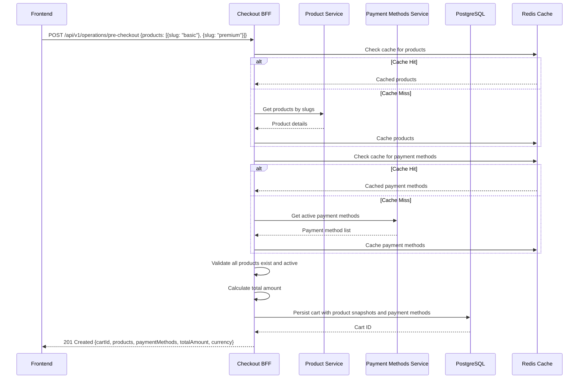

# Pre-Checkout Functional Specification

**Status**: Confirmed  
**Version**: 1.0  
**Last Updated**: 2026-11-23  
**Owner**: Business Analyst

---

## 1. Overview

### 1.1 Purpose
This document defines the functional requirements, business rules, user stories, and acceptance criteria for the Pre-Checkout operation of the Subscription Checkout BFF.

### 1.2 Scope
The Pre-Checkout operation prepares a checkout cart from the products selected by the frontend. It accepts a list of products (each with a slug), validates them against the Product Service, calculates the total amount, retrieves available payment methods, and returns a cart with product details, payment methods, and total. It is the entry point for the subscription checkout flow.

### 1.3 Related Documents
- [Product Vision](../../product/vision.md)
- [Project Scope](../../product/scope.md#21-pre-checkout)
- [Glossary](../../product/glossary.md)
- [Technical API Contracts](../technical/api-contracts.md#2-pre-checkout)
- [Architecture](../technical/architecture.md)

---

## 2. Functional Requirements

### FR-PRE-001: Create Checkout Cart from Product Slugs
**Priority**: Required  
**Status**: Confirmed

The system shall accept a list of products (each with a slug) from the frontend and create a checkout cart containing:
- Unique cart identifier (UUID)
- Product details (name, description, price, currency) for each requested slug
- Available payment methods for the cart
- Total price calculation

**Request Format**: `{ "products": [{ "slug": "premium" }] }`

### FR-PRE-002: Retrieve Product Information from Product Service
**Priority**: Required  
**Status**: Confirmed

The system shall retrieve product information through the Product Service interface (not hardcoded). The product catalog includes:

| Product Slug | Name | Monthly Price | Currency |
|--------------|------|---------------|----------|
| `basic` | Basic | 19.90 | BRL |
| `premium` | Premium | 39.90 | BRL |
| `family` | Family | 59.90 | BRL |

### FR-PRE-003: Retrieve Available Payment Methods
**Priority**: Required  
**Status**: Confirmed

The system shall retrieve available payment methods from the Payment Methods Service through its dedicated interface. Payment methods are returned in the pre-checkout response.

### FR-PRE-004: Return Standardized Response
**Priority**: Required  
**Status**: Confirmed

The system shall return a response containing:
- `cartId`: Unique identifier for the created cart (UUID)
- `products`: Array of product details (slug, name, description, price, currency) — **no internal IDs**
- `paymentMethods`: Array of available payment methods (name)
- `totalAmount`: Calculated total price (sum of all product prices)
- `currency`: Currency code (BRL)

**Note**: The response intentionally omits:
- Internal product IDs (`id` field)
- Any internal identifiers that could leak implementation details

### FR-PRE-005: Reject Invalid Products
**Priority**: Required  
**Status**: Confirmed

The system shall reject requests containing invalid or inactive product slugs using the standardized frontend error contract (see [Error Handling Specification](error-handling.md)).

---

## 3. Business Rules

### BR-PRE-001: Product Validation
**Rule**: All product slugs in the request must correspond to active products in the Product Service.  
**Enforcement Point**: Pre-Checkout use case execution  
**Violation Result**: Return `PRODUCT_NOT_FOUND` error with details of invalid slugs

### BR-PRE-002: Product Snapshot Preservation
**Rule**: Product information (name, description, price, currency) must be captured at pre-checkout time and preserved with the cart.  
**Rationale**: Ensures cart retains information presented to frontend even if external catalog changes later.  
**Enforcement Point**: Cart creation persistence

### BR-PRE-003: Payment Method Validation at Checkout
**Rule**: Payment methods are returned in pre-checkout. At checkout time, the selected payment method is validated against the Payment Methods Service.  
**Enforcement Point**: Checkout use case execution

### BR-PRE-004: Cart Uniqueness
**Rule**: Each pre-checkout request creates a new unique cart. No cart reuse across requests.  
**Enforcement Point**: Cart creation with generated UUID

### BR-PRE-005: Empty Cart Rejection
**Rule**: A pre-checkout request with an empty product list shall be rejected.  
**Enforcement Point**: Input validation  
**Violation Result**: Return `INVALID_REQUEST` error

### BR-PRE-006: Duplicate Product Handling
**Rule**: If the same product slug appears multiple times in the request, it shall be treated as a single product (unique slugs only).  
**Enforcement Point**: Request processing  
**Note**: The API contract specifies `uniqueItems: true` for products array.

### BR-PRE-007: Cart Total Calculation
**Rule**: Total amount is the sum of individual product prices. No discounts or taxes applied at pre-checkout.  
**Enforcement Point**: Cart creation

---

## 4. User Stories

### US-PRE-001: Basic Pre-Checkout
**As a** frontend application  
**I want to** send a list of products (each with a slug) and receive a cart with product details, payment methods, and total amount  
**So that** the user can review their selection and choose a payment method before proceeding to payment

**Acceptance Criteria**: See AC-PRE-001

### US-PRE-002: Invalid Product Handling
**As a** frontend application  
**I want to** receive a clear error when an invalid product slug is provided  
**So that** I can display an appropriate message to the user

**Acceptance Criteria**: See AC-PRE-002

### US-PRE-003: Price Transparency
**As a** frontend application  
**I want to** receive the total amount and currency in the pre-checkout response  
**So that** I can display the final price to the user before payment

**Acceptance Criteria**: See AC-PRE-003

---

## 5. Acceptance Criteria

### AC-PRE-001: Successful Pre-Checkout
**Given** a valid list of products (e.g., `[{ "slug": "basic" }, { "slug": "premium" }]`)  
**And** all products exist and are active in the Product Service  
**When** the frontend calls `POST /api/v1/operations/pre-checkout`  
**Then** the response shall contain:
- HTTP 201 Created
- `cartId`: UUID string
- `products`: Array with both products including correct slug, name, description, price, and currency (no internal `id` field)
- `paymentMethods`: Array with payment method names (e.g., "Cartão de Crédito", "Cartão de Débito", "Pix")
- `totalAmount`: Sum of product prices (59.80 for basic + premium)
- `currency`: "BRL"

### AC-PRE-002: Invalid Product Slug
**Given** a request containing an invalid product slug (e.g., `[{ "slug": "basic" }, { "slug": "invalid-slug" }]`)  
**When** the frontend calls `POST /api/v1/operations/pre-checkout`  
**Then** the response shall contain:
- HTTP 400 Bad Request (or 422 Unprocessable Entity)
- Standardized error contract with:
  - `displayType`: "BLOCK"
  - `errorCode`: "PRODUCT_NOT_FOUND"
  - `frontendError.code`: "P-1004"
  - `frontendError.title`: "Produto não encontrado"
  - `frontendError.description`: Details including the invalid slug(s)
  - `frontendError.primaryButton.label`: "Retornar"
  - `frontendError.primaryButton.url`: "/"

### AC-PRE-003: Inactive Product
**Given** a request containing a slug for an inactive product (e.g., `[{ "slug": "discontinued-plan" }]`)  
**When** the frontend calls `POST /api/v1/operations/pre-checkout`  
**Then** the response shall contain:
- HTTP 400/422
- Standardized error contract with:
  - `displayType`: "BLOCK"
  - `errorCode`: "PRODUCT_UNAVAILABLE"
  - `frontendError.code`: "P-1005"
  - `frontendError.title`: "Produto indisponível"
  - `frontendError.description`: Details of unavailable products
  - `frontendError.primaryButton.label`: "Retornar"
  - `frontendError.primaryButton.url`: "/"

### AC-PRE-004: Empty Product List
**Given** a request with an empty product list `{ "products": [] }`  
**When** the frontend calls `POST /api/v1/operations/pre-checkout`  
**Then** the response shall contain:
- HTTP 400 Bad Request
- Standardized error contract with:
  - `displayType`: "BLOCK"
  - `errorCode`: "INVALID_REQUEST"
  - `frontendError.code`: "P-1007"
  - `frontendError.title`: "Carrinho Inválido"
  - `frontendError.description`: "Pelo menos um produto é necessário."
  - `frontendError.primaryButton.label`: "Tentar novamente"
  - `frontendError.primaryButton.url`: "RETRY"

### AC-PRE-005: Single Product Pre-Checkout
**Given** a request with a single product `{ "products": [{ "slug": "family" }] }`  
**When** the frontend calls `POST /api/v1/operations/pre-checkout`  
**Then** the response shall contain:
- HTTP 201 Created
- `totalAmount`: 59.90
- `products` array with one element (slug, name, description, price, currency - no internal `id`)
- `paymentMethods`: Array with payment method names
- `currency`: "BRL"

### AC-PRE-006: Payment Methods Returned
**Given** a valid pre-checkout request  
**When** the response is returned  
**Then** the response shall contain a `paymentMethods` field with array of payment method names  
**And** payment methods are retrieved from Payment Methods Service at pre-checkout time

### AC-PRE-007: Cart Persistence
**Given** a successful pre-checkout response with `cartId`  
**When** the cart is retrieved from persistence  
**Then** the cart shall contain:
- The same `cartId`
- Product snapshots with prices at time of creation (slug, name, description, price, currency)
- Status: "PENDING"
- Created timestamp
- Associated payment methods available at creation time

### AC-PRE-008: Response Caching
**Given** multiple identical pre-checkout requests for the same product combination  
**When** the Product Service and Payment Methods Service responses are cached in Redis  
**Then** subsequent requests should be served from cache (performance requirement, not functional)

---

## 6. Error Scenarios

| Scenario | HTTP Status | Error Code | Frontend Code | Description |
|----------|-------------|------------|---------------|-------------|
| Empty product list | 400 | INVALID_REQUEST | P-1007 | At least one product is required |
| Invalid product slug | 400/422 | PRODUCT_NOT_FOUND | P-1004 | Product not found: {slug} |
| Inactive product | 400/422 | PRODUCT_UNAVAILABLE | P-1005 | Product not available: {slug} |
| Product Service unavailable | 503 | SERVICE_UNAVAILABLE | P-9999 | Payment service temporarily unavailable |
| Internal server error | 500 | INTERNAL_ERROR | P-9998 | Unexpected error occurred |

---

## 7. Data Flow

---

## 8. Traceability Matrix

| Requirement | User Story | Acceptance Criteria | Business Rule | Technical Spec |
|-------------|------------|---------------------|---------------|----------------|
| FR-PRE-001 | US-PRE-001 | AC-PRE-001, AC-PRE-005 | BR-PRE-001, BR-PRE-004, BR-PRE-007 | API-PRE-001 |
| FR-PRE-002 | US-PRE-001 | AC-PRE-001, AC-PRE-002, AC-PRE-003 | BR-PRE-001, BR-PRE-002 | API-PRE-001 |
| FR-PRE-003 | US-PRE-001 | AC-PRE-001, AC-PRE-006 | BR-PRE-003 | API-PRE-001 |
| FR-PRE-004 | US-PRE-001, US-PRE-003 | AC-PRE-001, AC-PRE-005 | BR-PRE-002, BR-PRE-007 | API-PRE-001 |
| FR-PRE-005 | US-PRE-002 | AC-PRE-002, AC-PRE-003, AC-PRE-004 | BR-PRE-001, BR-PRE-005, BR-PRE-006 | API-PRE-001 |

---

## 9. Assumptions and Constraints

### Assumptions
- Product Service and Payment Methods Service are available (may be mocked for local dev)
- Product slugs are unique and stable identifiers
- Prices are in BRL with 2 decimal places
- Cart TTL is 30 minutes (configurable)
- Frontend handles correlation IDs for tracing

### Constraints
- No real payment gateway integration in pre-checkout
- Product catalog ownership remains with Product Service
- Payment method catalog ownership remains with Payment Methods Service
- Full card numbers and CVV never persisted (handled in checkout phase)

---

## 10. Open Questions

None at this time.