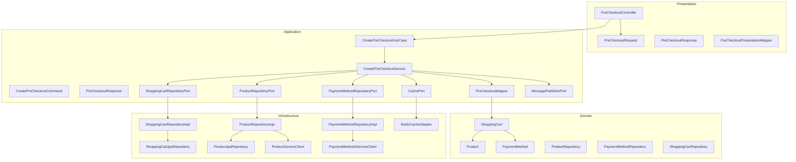
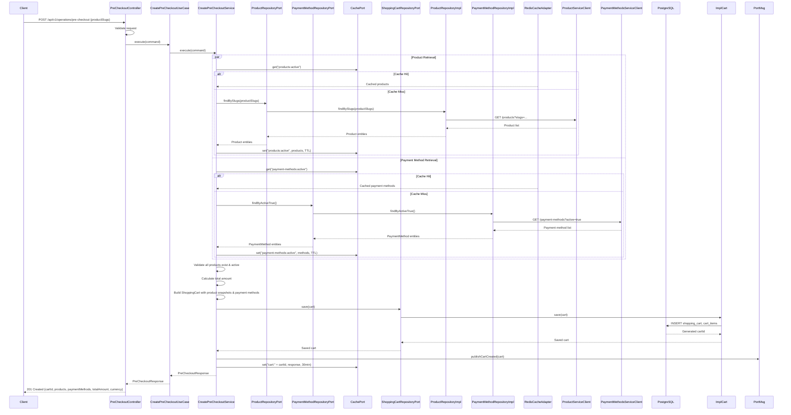
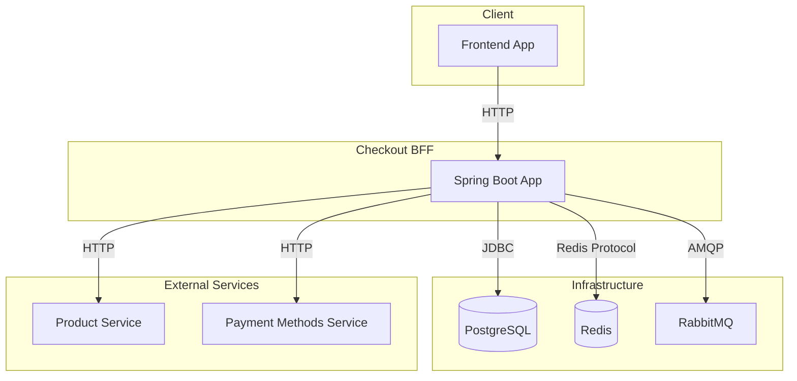

# Architecture Specification

**Status**: Confirmed  
**Version**: 1.0  
**Last Updated**: 2026-11-23  
**Owner**: Solution Architect

---

## 1. Architecture Overview

The Checkout BFF follows **Clean Architecture** principles with a layered structure:

```
┌─────────────────────────────────────────────────────────────────┐
│                      Presentation Layer                         │
│  Controllers │ Request/Response DTOs │ Presentation Mappers     │
├─────────────────────────────────────────────────────────────────┤
│                       Application Layer                         │
│  Use Cases │ DTOs │ Mappers │ Input/Output Ports │ Events      │
├─────────────────────────────────────────────────────────────────┤
│                        Domain Layer                             │
│  Entities │ Repository Interfaces │ Domain Services │ Events   │
├─────────────────────────────────────────────────────────────────┤
│                     Infrastructure Layer                        │
│  JPA Repositories │ Repository Impl │ Cache │ Messaging │ Config│
└─────────────────────────────────────────────────────────────────┘
```

---

## 2. Layer Responsibilities

### 2.1 Presentation Layer
**Package**: `com.checkout.bff.presentation`

| Component | Responsibility |
|-----------|----------------|
| Controllers | Handle HTTP requests/responses, validation, status codes |
| Request DTOs | Input validation, API contract compliance |
| Response DTOs | Output formatting, API contract compliance |
| Presentation Mappers | Map between application DTOs and presentation DTOs |

**Pre-Checkout Controller**:
- `POST /api/v1/operations/pre-checkout`
- Validates request body
- Delegates to `CreatePreCheckoutUseCase`
- Maps response to `PreCheckoutResponse`

**Sync Checkout Controller**:
- `POST /api/v1/operations/checkout`
- Validates request body (cartId, paymentMethod)
- Delegates to `ProcessSyncCheckoutUseCase`
- Maps response to `SyncCheckoutResponse`

**Async Checkout Controller**:
- `POST /api/v1/operations/checkout/async`
- Validates request body
- Delegates to `InitiateAsyncCheckoutUseCase`
- Returns 202 Accepted

**Cart Status Controller**:
- `GET /api/v1/operations/cart/{cartId}`
- Delegates to `GetCartStatusUseCase`

### 2.2 Application Layer
**Package**: `com.checkout.bff.application`

| Component | Responsibility |
|-----------|----------------|
| Use Cases (Input Ports) | Define application operations (interfaces) |
| Services (Use Case Impl) | Orchestrate domain logic, coordinate ports |
| DTOs | Data transfer between layers |
| Mappers (MapStruct) | Map between domain entities and DTOs |
| Output Ports | Define external dependencies (interfaces) |
| Events | Application-level events for async processing |

**Pre-Checkout Use Case**:
```java
interface CreatePreCheckoutUseCase {
    PreCheckoutResponse execute(CreatePreCheckoutCommand command);
}
```

**Sync Checkout Use Case**:
```java
interface ProcessSyncCheckoutUseCase {
    SyncCheckoutResponse execute(ProcessSyncCheckoutCommand command);
}
```

**Async Checkout Use Case**:
```java
interface InitiateAsyncCheckoutUseCase {
    AsyncCheckoutResponse execute(InitiateAsyncCheckoutCommand command);
}
```

### 2.3 Domain Layer
**Package**: `com.checkout.bff.domain`

| Component | Responsibility |
|-----------|----------------|
| Entities | Core business objects with identity and lifecycle |
| Repository Interfaces | Define persistence contracts (no implementation) |
| Domain Services | Business logic not fitting in a single entity |
| Domain Events | Events representing domain occurrences |
| Value Objects | Immutable objects without identity |
| Exceptions | Domain-specific exceptions |

**Key Domain Entities**:
- `ShoppingCart` - Aggregate root for cart
- `CartItem` - Product snapshot within cart
- `PaymentMethod` - Available payment method reference
- `Product` - Product catalog entity

### 2.4 Infrastructure Layer
**Package**: `com.checkout.bff.infrastructure`

| Component | Responsibility |
|-----------|----------------|
| JPA Repositories | Spring Data JPA interfaces |
| Repository Implementations | Implement domain repository ports |
| Cache Adapters | Redis implementation of CachePort |
| Messaging Publishers | RabbitMQ implementation of MessagePublisherPort |
| External Clients | HTTP clients for Product Service, Payment Methods Service |
| Configuration | Infrastructure beans, datasource, etc. |

---

## 3. Pre-Checkout Component Diagram



---

## 4. Pre-Checkout Sequence Diagram



---

## 5. Data Flow Architecture

### 5.1 Request Flow
1. **Controller** receives HTTP request
2. **Validation** - Bean Validation (JSR-380) on request DTO
3. **Mapper** - Presentation mapper converts to application command
4. **Use Case** - Application service orchestrates business logic
5. **Ports** - Calls output ports (interfaces)
6. **Adapters** - Infrastructure implements ports
7. **External** - Calls external services (with caching)
8. **Persistence** - Saves domain entities via JPA
9. **Events** - Publishes domain events for async processing
10. **Response** - Maps domain result to response DTO

### 5.2 Caching Strategy
- **Products**: Cache key `products:active` or `products:{slug}`, TTL 10 minutes
- **Payment Methods**: Cache key `payment-methods:active`, TTL 15 minutes
- **Carts**: Cache key `cart:{cartId}`, TTL 30 minutes
- **Invalidation**: On cache miss, fetch from source and populate

### 5.3 External Service Integration
- **Product Service**: REST client, timeout 3s, retry 2x with exponential backoff
- **Payment Methods Service**: REST client, timeout 3s, retry 2x with exponential backoff
- **Circuit Breaker**: Resilience4j (planned) for external calls
- **Fallback**: Return cached data if available, otherwise error

---

## 6. Technology Stack

| Layer | Technology | Version |
|-------|------------|---------|
| Language | Java | 21 |
| Framework | Spring Boot | 3.2.5 |
| Persistence | Spring Data JPA + Hibernate | 6.4.x |
| Database | PostgreSQL | 16 |
| Cache | Spring Data Redis + Lettuce | 7.x |
| Messaging | Spring AMQP + RabbitMQ | 3.13 |
| Mapping | MapStruct | 1.5.5.Final |
| Validation | Jakarta Bean Validation | 3.0 |
| API Docs | SpringDoc OpenAPI | 2.5.0 |
| Testing | JUnit 5, Mockito, Testcontainers | Latest |
| Build | Maven | 3.9+ |

---

## 7. Configuration

### 7.1 Application Properties (Key Settings)

```yaml
spring:
  application:
    name: checkout-bff
  datasource:
    url: ${POSTGRES_URL:jdbc:postgresql://localhost:5432/checkout_db}
    username: ${POSTGRES_USER:postgres}
    password: ${POSTGRES_PASSWORD:postgres}
  jpa:
    hibernate:
      ddl-auto: validate
    show-sql: false
    properties:
      hibernate:
        format_sql: true
        dialect: org.hibernate.dialect.PostgreSQLDialect
  flyway:
    enabled: true
    locations: classpath:db/migration
  redis:
    host: ${REDIS_HOST:localhost}
    port: ${REDIS_PORT:6379}
    password: ${REDIS_PASSWORD:}
  rabbitmq:
    host: ${RABBITMQ_HOST:localhost}
    port: ${RABBITMQ_PORT:5672}
    username: ${RABBITMQ_USER:guest}
    password: ${RABBITMQ_PASSWORD:guest}

cache:
  products:
    ttl-minutes: 10
  payment-methods:
    ttl-minutes: 15
  cart:
    ttl-minutes: 30

external:
  product-service:
    base-url: ${PRODUCT_SERVICE_URL:http://localhost:8081}
    timeout-ms: 3000
    retry:
      max-attempts: 3
      backoff-ms: 500
  payment-methods-service:
    base-url: ${PAYMENT_METHODS_SERVICE_URL:http://localhost:8082}
    timeout-ms: 3000
    retry:
      max-attempts: 3
      backoff-ms: 500
```

---

## 8. Deployment Architecture



---

## 9. Security Considerations

| Concern | Mitigation |
|---------|------------|
| SQL Injection | JPA parameterized queries, no raw SQL |
| XSS | JSON responses, proper Content-Type |
| CSRF | Stateless API, no session cookies |
| Sensitive Data | Never log payment data, mask in logs |
| Rate Limiting | Spring Boot Actuator + Gateway (planned) |
| Input Validation | Bean Validation on all request DTOs |

---

## 10. Observability

### 10.1 Logging
- Structured JSON logging (Logback + Logstash encoder)
- Correlation ID propagation via `X-Correlation-ID` header
- Log levels: ERROR, WARN, INFO, DEBUG

### 10.2 Metrics (Micrometer + Prometheus)
- HTTP request duration, count, error rate
- Cache hit/miss ratio
- External service latency
- Database connection pool usage
- RabbitMQ queue depths

### 10.3 Tracing
- Micrometer Tracing + OpenTelemetry (planned)
- Correlation IDs across sync and async boundaries

### 10.4 Health Checks
- `GET /actuator/health` - Liveness
- `GET /actuator/health/readiness` - Readiness (DB, Redis, RabbitMQ)

---

## 11. ADR References

| ADR | Title | Status |
|-----|-------|--------|
| ADR-001 | Clean Architecture Layering | Accepted |
| ADR-002 | Spring Boot 3 + Java 21 | Accepted |
| ADR-003 | PostgreSQL for Persistence | Accepted |
| ADR-004 | Redis for Caching | Accepted |
| ADR-005 | RabbitMQ for Async Messaging | Accepted |
| ADR-006 | MapStruct for Mapping | Accepted |
| ADR-007 | Transactional Outbox Pattern | Accepted |

---

## 12. Traceability

| Architecture Element | Functional Requirement | Technical Spec |
|----------------------|------------------------|----------------|
| PreCheckoutController | FR-PRE-001..005 | API-PRE-001..006 |
| CreatePreCheckoutService | FR-PRE-001..004 | BR-PRE-001..007 |
| ProductRepositoryPort/Impl | FR-PRE-002 | API-PRE-002 |
| PaymentMethodRepositoryPort/Impl | FR-PRE-003 | API-PRE-002 |
| ShoppingCartRepositoryPort/Impl | BR-PRE-002, BR-PRE-003 | AC-PRE-007 |
| RedisCacheAdapter | NFR: Performance | Caching Spec |
| External Service Clients | FR-PRE-002, FR-PRE-003 | API Contracts |
| SyncCheckoutController | FR-CHK-001 | API-CHK-001 |
| AsyncCheckoutController | FR-CHK-002 | API-CHK-002 |