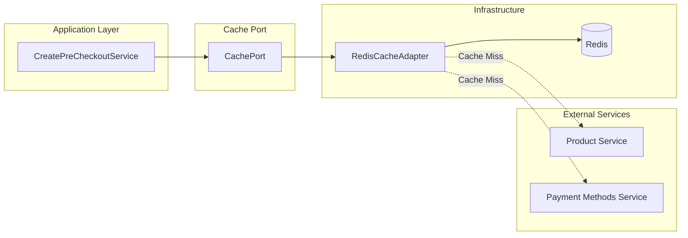
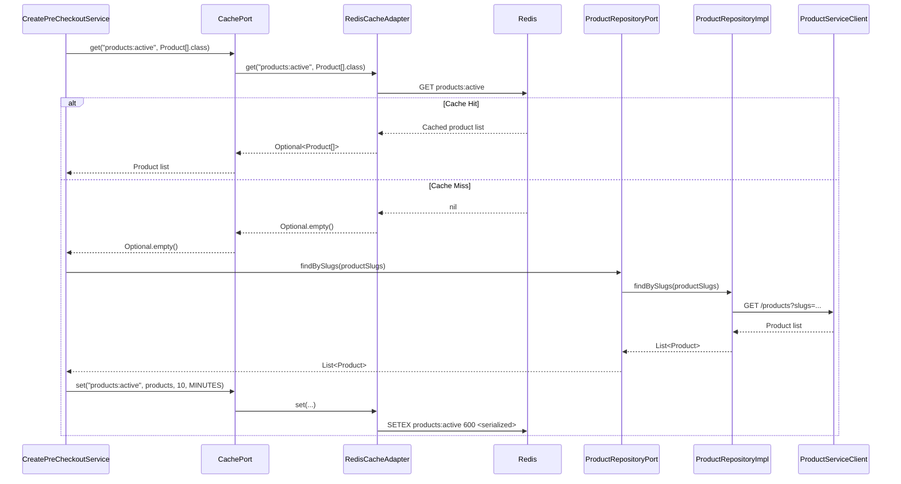

# Caching Specification

**Status**: Confirmed  
**Version**: 1.0  
**Last Updated**: 2026-11-23  
**Owner**: Solution Architect

---

## 1. Overview

This document defines the caching strategy for the Checkout BFF using Redis. Caching is applied to external service responses to improve performance and reduce latency.

---

## 2. Cache Architecture



---

## 3. Cache Port Interface

```java
public interface CachePort {
    void set(String key, Object value, long timeout, TimeUnit unit);
    <T> Optional<T> get(String key, Class<T> type);
    void delete(String key);
    boolean exists(String key);
}
```

---

## 4. Cache Keys & TTL Configuration

### 4.1 Cache Key Naming Convention

Pattern: `{domain}:{entity}:{identifier}`

| Domain | Entity | Key Pattern | Example |
|--------|--------|-------------|---------|
| Product | All Active | `products:active` | `products:active` |
| Product | By Slug | `products:slug:{slug}` | `products:slug:basic` |
| Product | By Slugs | `products:slugs:{hash}` | `products:slugs:a1b2c3` |
| Payment Method | Active | `payment-methods:active` | `payment-methods:active` |
| Cart | By ID | `cart:{cartId}` | `cart:a1b2c3d4-e5f6` |

### 4.2 TTL Configuration

| Cache Entry | TTL | Rationale |
|-------------|-----|-----------|
| Products (all/by slug) | 10 minutes | Product catalog changes infrequently |
| Payment Methods (active) | 15 minutes | Payment methods change rarely |
| Cart (by ID) | 30 minutes | Matches cart session TTL |

### 4.3 Configuration Properties

```yaml
cache:
  products:
    ttl-minutes: 10
  payment-methods:
    ttl-minutes: 15
  cart:
    ttl-minutes: 30
```

---

## 5. Pre-Checkout Caching Flow

### 5.1 Product Retrieval with Caching



### 5.2 Payment Methods Retrieval with Caching

Similar flow using key `payment-methods:active` with 15-minute TTL.

---

## 6. Cache Invalidation Strategy

### 6.1 Passive Invalidation (TTL-based)
- Primary strategy: Time-based expiration
- No active invalidation on external service changes
- Acceptable staleness: Up to TTL duration

### 6.2 Active Invalidation (Future Enhancement)
- Listen for cache invalidation events from external services
- Implement `CacheInvalidationEvent` consumer
- Invalidate specific keys on product/payment method updates

### 6.3 Cache Warming (Optional)
- Pre-populate cache on application startup
- Background job to refresh before expiry

---

## 7. Redis Configuration

### 7.1 Connection Settings

```yaml
spring:
  redis:
    host: ${REDIS_HOST:localhost}
    port: ${REDIS_PORT:6379}
    password: ${REDIS_PASSWORD:}
    lettuce:
      pool:
        max-active: 8
        max-idle: 8
        min-idle: 2
      shutdown-timeout: 100ms
```

### 7.2 Serialization

- **Default**: JDK serialization (for generic Object storage)
- **Recommended**: JSON (Jackson) for better interoperability
- **Configuration**: Custom `RedisTemplate` with `Jackson2JsonRedisSerializer`

```java
@Bean
public RedisTemplate<String, Object> redisTemplate(RedisConnectionFactory factory) {
    var template = new RedisTemplate<String, Object>();
    template.setConnectionFactory(factory);
    template.setKeySerializer(new StringRedisSerializer());
    template.setValueSerializer(new Jackson2JsonRedisSerializer<>(Object.class));
    template.setHashKeySerializer(new StringRedisSerializer());
    template.setHashValueSerializer(new Jackson2JsonRedisSerializer<>(Object.class));
    return template;
}
```

---

## 8. Error Handling

| Scenario | Behavior |
|----------|----------|
| Redis unavailable (read) | Log warning, proceed without cache (cache miss) |
| Redis unavailable (write) | Log warning, continue without caching |
| Serialization error | Log error, treat as cache miss |
| Deserialization error | Log error, delete corrupted key, treat as cache miss |

**Circuit Breaker**: Implement Resilience4j circuit breaker for Redis operations (planned).

---

## 9. Consistency Guarantees

| Aspect | Guarantee |
|--------|-----------|
| Read-your-writes | Not guaranteed (async replication) |
| Cache coherence | Eventual (TTL-based) |
| Stale reads possible | Yes, within TTL window |
| Cart consistency | Strong (cart reads bypass cache for writes) |

**Note**: Cart caching is read-only optimization. Cart creation/updates always write to DB first, then update cache.

---

## 10. Monitoring & Observability

### 10.1 Key Metrics

| Metric | Description | Target |
|--------|-------------|--------|
| `cache.hit.ratio` | Hits / (Hits + Misses) | > 80% |
| `cache.latency.ms` | Redis operation latency | < 5ms p99 |
| `cache.errors` | Redis operation errors | 0 |
| `cache.memory.usage` | Redis memory consumption | < 80% max |

### 10.2 Health Check

```yaml
management:
  health:
    redis:
      enabled: true
```

---

## 11. Pre-Checkout Specific Cache Behavior

### 11.1 Cache Population During Pre-Checkout

1. **Products**: Cached on first miss during pre-checkout
2. **Payment Methods**: Cached on first miss during pre-checkout
3. **Cart Response**: Cached after successful cart creation (key: `cart:{cartId}`)

### 11.2 Cache Usage in Subsequent Operations

- **Get Cart**: Check `cart:{cartId}` first, fallback to DB
- **Checkout**: Read cart from DB (not cache) for consistency
- **Add Item**: Invalidate `cart:{cartId}` after modification

### 11.3 Cache Key for Product Slugs Combination

For requests with multiple slugs, use a hash of sorted slugs:
```
products:slugs:{sha256(sorted_slugs_joined)}
```

---

## 12. Traceability

| Cache Element | Functional Requirement | Technical Spec |
|---------------|------------------------|----------------|
| Product caching | FR-PRE-002 (performance) | Architecture §5.2 |
| Payment method caching | FR-PRE-003 (performance) | Architecture §5.2 |
| Cart caching | NFR: Performance | Architecture §5.2 |
| CachePort interface | Architecture | Architecture §2.4 |
| RedisCacheAdapter | Architecture | Architecture §2.4 |
| TTL configuration | NFR: Performance | This doc §4.2 |