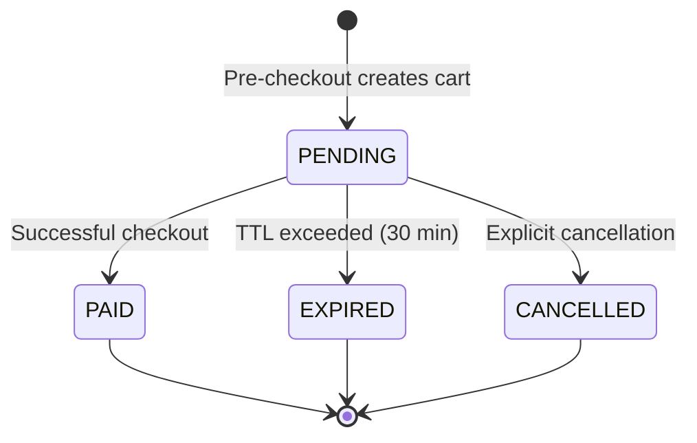

# Database Specification

**Status**: Confirmed  
**Version**: 2.1  
**Last Updated**: 2026-11-27  
**Owner**: Solution Architect / Technical Analyst

---

## 1. Overview

This document defines the database schema, entity relationships, and persistence strategy for the Checkout BFF multi-service architecture. Each service has its own PostgreSQL 16 database, managed via Flyway migrations.

### Service Databases

| Service | Database Name | Purpose |
|---------|---------------|---------|
| checkout-bff | `checkout_bff` | Carts, items, checkout operations, outbox |
| product-service | `product_service` | Product catalog |
| payment-service | `payment_service` | Payment methods, outbox |

---

## 2. Entity Relationship Diagram

```mermaid
erDiagram
    SHOPPING_CART ||--o{ CART_ITEM : contains
    SHOPPING_CART ||--o{ CART_PAYMENT_METHOD : "has available"
    CART_PAYMENT_METHOD }|--|| PAYMENT_METHOD : "method"
    CART_ITEM }|--|| PRODUCT : references
    SHOPPING_CART ||--o{ CHECKOUT_OPERATION : initiates
    CHECKOUT_OPERATION ||--|| OUTBOX_EVENT : publishes
    
    SHOPPING_CART {
        bigint id PK
        uuid public_id UK
        numeric(10,2) price
        varchar(3) currency
        varchar(50) status
        timestamp paid_at
        timestamp created_at
    }
    
    CART_ITEM {
        bigint id PK
        bigint cart_id FK
        bigint product_id FK
        int quantity
    }
    
    PRODUCT {
        bigint id PK
        varchar(100) slug UK
        varchar(200) name
        text description
        numeric(10,2) price
        varchar(3) currency
        boolean active
    }
    
    PAYMENT_METHOD {
        bigint id PK
        varchar(100) name UK
        varchar(50) normalized_name UK
        boolean active
    }
    
    CART_PAYMENT_METHOD {
        bigint id PK
        bigint cart_id FK
        uuid public_cart_id
        bigint payment_method_id FK
        varchar(100) payment_method_name
    }
    
    CHECKOUT_OPERATION {
        bigint id PK
        uuid public_id UK
        bigint cart_id FK
        varchar(50) status
        varchar(50) payment_method_type
        varchar(100) payment_method_name
        numeric(10,2) amount
        varchar(3) currency
        varchar(20) masked_card_number
        text pix_code
        varchar(100) authorization_code
        varchar(500) failure_reason
        varchar(100) idempotency_key UK
        timestamp created_at
        timestamp updated_at
        timestamp processed_at
    }
    
    OUTBOX_EVENT {
        bigint id PK
        varchar(36) event_id UK
        varchar(100) event_type
        jsonb payload
        varchar(200) routing_key
        varchar(100) exchange
        timestamp created_at
        timestamp published_at
        int retry_count
        text last_error
    }
```

---

## 3. Table Definitions

### 3.1 shopping_cart

| Column | Type | Constraints | Description |
|--------|------|-------------|-------------|
| `id` | `BIGSERIAL` | `PRIMARY KEY` | Unique cart identifier |
| `public_id` | `UUID` | `NOT NULL`, `UNIQUE`, `DEFAULT uuid_generate_v4()` | External-facing cart ID |
| `price` | `NUMERIC(10,2)` | `NOT NULL` | Total cart price |
| `currency` | `VARCHAR(3)` | `NOT NULL` | ISO 4217 currency code (BRL) |
| `status` | `VARCHAR(50)` | `NOT NULL` | Cart status: PENDING, PAID, EXPIRED, CANCELLED |
| `paid_at` | `TIMESTAMP` | `NULL` | Timestamp when cart was paid |
| `created_at` | `TIMESTAMP` | `NOT NULL`, `DEFAULT now()` | Cart creation timestamp |

**Indexes**:
- `idx_shopping_cart_public_id` (unique) on `public_id`
- `idx_shopping_cart_status` on `status`
- `idx_shopping_cart_created_at` on `created_at`

### 3.2 cart_item

| Column | Type | Constraints | Description |
|--------|------|-------------|-------------|
| `id` | `BIGSERIAL` | `PRIMARY KEY` | Unique item identifier |
| `cart_id` | `BIGINT` | `NOT NULL`, `FK -> shopping_cart.id` | Reference to cart |
| `product_id` | `BIGINT` | `NOT NULL`, `FK -> product.id` | Reference to product |
| `quantity` | `INTEGER` | `NOT NULL`, `DEFAULT 1` | Item quantity |

**Indexes**:
- `idx_cart_item_cart_id` on `cart_id`
- `idx_cart_item_product_id` on `product_id`
- Unique constraint on `(cart_id, product_id)` - one item per product per cart

### 3.3 product

| Column | Type | Constraints | Description |
|--------|------|-------------|-------------|
| `id` | `BIGSERIAL` | `PRIMARY KEY` | Unique product identifier |
| `slug` | `VARCHAR(100)` | `NOT NULL`, `UNIQUE` | Product slug (e.g., 'basic') |
| `name` | `VARCHAR(200)` | `NOT NULL` | Display name |
| `description` | `TEXT` | `NULL` | Product description |
| `price` | `NUMERIC(10,2)` | `NOT NULL` | Price in currency |
| `currency` | `VARCHAR(3)` | `NOT NULL` | ISO 4217 code (BRL) |
| `active` | `BOOLEAN` | `NOT NULL`, `DEFAULT true` | Whether product is available |

**Indexes**:
- `idx_product_slug` (unique) on `slug`
- `idx_product_active` on `active`

**Initial Data**:
```sql
INSERT INTO product (slug, name, description, price, currency, active) VALUES
('basic', 'Basic', 'Basic subscription plan', 19.90, 'BRL', true),
('premium', 'Premium', 'Premium subscription plan', 39.90, 'BRL', true),
('family', 'Family', 'Family subscription plan', 59.90, 'BRL', true);
```

### 3.4 payment_method

| Column | Type | Constraints | Description |
|--------|------|-------------|-------------|
| `id` | `BIGSERIAL` | `PRIMARY KEY` | Unique payment method identifier |
| `name` | `VARCHAR(100)` | `NOT NULL`, `UNIQUE` | Display name (e.g., 'Cartão de Crédito') |
| `normalized_name` | `VARCHAR(50)` | `NOT NULL`, `UNIQUE` | Normalized type for inter-service communication (e.g., 'CREDIT_CARD') |
| `active` | `BOOLEAN` | `NOT NULL`, `DEFAULT true` | Whether method is available |

**Indexes**:
- `idx_payment_method_name` (unique) on `name`
- `idx_payment_method_normalized_name` (unique) on `normalized_name`
- `idx_payment_method_active` on `active`

**Initial Data** (both checkout-bff and payment-service):
```sql
INSERT INTO payment_method (name, normalized_name, active) VALUES
('Cartão de Crédito', 'CREDIT_CARD', true),
('Cartão de Débito', 'DEBIT_CARD', true),
('Pix', 'PIX', true);
```

### 3.5 cart_payment_method

| Column | Type | Constraints | Description |
|--------|------|-------------|-------------|
| `id` | `BIGSERIAL` | `PRIMARY KEY` | Unique association identifier |
| `cart_id` | `BIGINT` | `NOT NULL`, `FK -> shopping_cart.id` | Reference to cart |
| `public_cart_id` | `UUID` | `NOT NULL` | Denormalized cart public_id for queries |
| `payment_method_id` | `BIGINT` | `NOT NULL`, `FK -> payment_method.id` | Available payment method |
| `payment_method_name` | `VARCHAR(100)` | `NOT NULL` | Denormalized payment method name |

**Indexes**:
- `idx_cart_payment_method_cart_id` on `cart_id`
- `idx_cart_payment_method_public_cart_id` on `public_cart_id`
- `idx_cart_payment_method_payment_method_id` on `payment_method_id`

### 3.6 checkout_operation

| Column | Type | Constraints | Description |
|--------|------|-------------|-------------|
| `id` | `BIGSERIAL` | `PRIMARY KEY` | Unique operation identifier |
| `public_id` | `UUID` | `NOT NULL`, `UNIQUE`, `DEFAULT gen_random_uuid()` | External-facing operation ID |
| `cart_id` | `BIGINT` | `NOT NULL`, `FK -> shopping_cart.id` | Reference to cart |
| `status` | `VARCHAR(50)` | `NOT NULL`, `DEFAULT 'PENDING'` | Status: PENDING, PROCESSING, APPROVED, DECLINED, FAILED |
| `payment_method_type` | `VARCHAR(50)` | `NOT NULL` | Type: CREDIT_CARD, DEBIT_CARD, PIX |
| `payment_method_name` | `VARCHAR(100)` | `NULL` | Display name of payment method |
| `amount` | `NUMERIC(10,2)` | `NOT NULL` | Operation amount |
| `currency` | `VARCHAR(3)` | `NOT NULL`, `DEFAULT 'BRL'` | ISO 4217 currency code |
| `masked_card_number` | `VARCHAR(20)` | `NULL` | Masked card number (e.g., "****1234") |
| `pix_code` | `TEXT` | `NULL` | PIX copy-paste code (EMV) |
| `authorization_code` | `VARCHAR(100)` | `NULL` | Authorization code from payment processor |
| `failure_reason` | `VARCHAR(500)` | `NULL` | Failure reason if declined/failed |
| `idempotency_key` | `VARCHAR(100)` | `UNIQUE` | Client-provided idempotency key |
| `created_at` | `TIMESTAMP` | `NOT NULL`, `DEFAULT CURRENT_TIMESTAMP` | Operation creation timestamp |
| `updated_at` | `TIMESTAMP` | `NULL` | Last update timestamp |
| `processed_at` | `TIMESTAMP` | `NULL` | Timestamp when payment was processed |

**Indexes**:
- `idx_checkout_operation_cart_id` on `cart_id`
- `idx_checkout_operation_public_id` on `public_id`
- `idx_checkout_operation_status` on `status`
- `idx_checkout_operation_idempotency_key` (unique) on `idempotency_key`
- `idx_checkout_operation_created_at` on `created_at`

**Constraints**:
- `chk_checkout_operation_status` CHECK (status IN ('PENDING', 'PROCESSING', 'APPROVED', 'DECLINED', 'FAILED'))

### 3.7 outbox (checkout-bff)

| Column | Type | Constraints | Description |
|--------|------|-------------|-------------|
| `id` | `BIGSERIAL` | `PRIMARY KEY` | Unique event identifier |
| `event_id` | `VARCHAR(36)` | `NOT NULL`, `UNIQUE` | UUID for event deduplication |
| `event_type` | `VARCHAR(100)` | `NOT NULL` | Event type (e.g., 'ORDER_CREATED') |
| `payload` | `JSONB` | `NOT NULL` | Event payload |
| `routing_key` | `VARCHAR(200)` | `NOT NULL` | RabbitMQ routing key |
| `exchange` | `VARCHAR(100)` | `NOT NULL`, `DEFAULT 'checkout.exchange'` | RabbitMQ exchange |
| `created_at` | `TIMESTAMP` | `NOT NULL`, `DEFAULT CURRENT_TIMESTAMP` | Event creation timestamp |
| `published_at` | `TIMESTAMP` | `NULL` | Timestamp when published |
| `retry_count` | `INT` | `NOT NULL`, `DEFAULT 0` | Number of publish retries |
| `last_error` | `TEXT` | `NULL` | Last error message if failed |

**Indexes**:
- `idx_outbox_unpublished` on `published_at` WHERE `published_at IS NULL`
- `idx_outbox_created_at` on `created_at`
- `idx_outbox_event_id` on `event_id`

### 3.8 outbox (payment-service)

| Column | Type | Constraints | Description |
|--------|------|-------------|-------------|
| `id` | `BIGSERIAL` | `PRIMARY KEY` | Unique event identifier |
| `event_id` | `VARCHAR(36)` | `NOT NULL`, `UNIQUE` | UUID for event deduplication |
| `event_type` | `VARCHAR(100)` | `NOT NULL` | Event type |
| `payload` | `JSONB` | `NOT NULL` | Event payload |
| `routing_key` | `VARCHAR(200)` | `NOT NULL` | RabbitMQ routing key |
| `exchange` | `VARCHAR(100)` | `NOT NULL`, `DEFAULT 'payment.exchange'` | RabbitMQ exchange |
| `created_at` | `TIMESTAMP` | `NOT NULL`, `DEFAULT CURRENT_TIMESTAMP` | Event creation timestamp |
| `published_at` | `TIMESTAMP` | `NULL` | Timestamp when published |
| `retry_count` | `INT` | `NOT NULL`, `DEFAULT 0` | Number of publish retries |
| `last_error` | `TEXT` | `NULL` | Last error message if failed |

**Indexes**:
- `idx_outbox_unpublished` on `published_at` WHERE `published_at IS NULL`
- `idx_outbox_created_at` on `created_at`
- `idx_outbox_event_id` on `event_id`

---

## 4. Pre-Checkout Specific Persistence

### 4.1 Cart Creation During Pre-Checkout

When pre-checkout executes, the following are persisted atomically:

1. **ShoppingCart** record with:
   - `status = 'PENDING'`
   - `price = calculated total`
   - `currency = 'BRL'`
   - `public_id` auto-generated

2. **CartItem** records for each product:
   - `cart_id` = new cart ID
   - `product_id` = product ID from catalog
   - `quantity` = 1 (unique slugs per request per API contract)

3. **Product Snapshot** (implicit via cart_item -> product FK):
   - Product details at time of cart creation are preserved
   - Price, name, description captured via FK to product table

4. **Payment Methods Association** (`cart_payment_method`):
   - Available payment method IDs stored for validation at checkout
   - Multiple payment methods can be offered per cart
   - Denormalized `public_cart_id` and `payment_method_name` for efficient queries

### 4.2 Cart Status Lifecycle



---

## 5. Flyway Migration Strategy

### 5.1 Migration Files

```
checkout-bff/src/main/resources/db/migration/
├── V1__create_initial_schema.sql
├── V2__add_product_catalog.sql
├── V3__add_payment_methods.sql
├── V4__add_cart_status_check.sql
├── V5__create_checkout_operation_table.sql
├── V6__create_outbox_table.sql
├── V7__create_cart_payment_method_table.sql
└── V8__expand_masked_card_number.sql

product-service/src/main/resources/db/migration/
├── V1__create_product_table.sql
└── V2__add_product_catalog.sql

payment-service/src/main/resources/db/migration/
├── V1__create_payment_method_table.sql
├── V2__add_payment_methods_data.sql
└── V3__create_outbox_table.sql
```

### 5.2 V1__create_initial_schema.sql (checkout-bff)

```sql
-- Enable UUID extension if needed
CREATE EXTENSION IF NOT EXISTS "uuid-ossp";

-- payment_method table
CREATE TABLE payment_method (
    id BIGSERIAL PRIMARY KEY,
    name VARCHAR(100) NOT NULL UNIQUE,
    active BOOLEAN NOT NULL DEFAULT true,
    normalized_name VARCHAR(50) NOT NULL DEFAULT 'UNKNOWN' UNIQUE
);

-- product table
CREATE TABLE product (
    id BIGSERIAL PRIMARY KEY,
    slug VARCHAR(100) NOT NULL UNIQUE,
    name VARCHAR(200) NOT NULL,
    description TEXT,
    price NUMERIC(10,2) NOT NULL,
    currency VARCHAR(3) NOT NULL,
    active BOOLEAN NOT NULL DEFAULT true
);

-- shopping_cart table
CREATE TABLE shopping_cart (
    id BIGSERIAL PRIMARY KEY,
    public_id UUID NOT NULL UNIQUE DEFAULT uuid_generate_v4(),
    price NUMERIC(10,2) NOT NULL,
    currency VARCHAR(3) NOT NULL,
    status VARCHAR(50) NOT NULL,
    paid_at TIMESTAMP,
    created_at TIMESTAMP NOT NULL DEFAULT CURRENT_TIMESTAMP
);

-- cart_item table
CREATE TABLE cart_item (
    id BIGSERIAL PRIMARY KEY,
    cart_id BIGINT NOT NULL REFERENCES shopping_cart(id) ON DELETE CASCADE,
    product_id BIGINT NOT NULL REFERENCES product(id),
    quantity INTEGER NOT NULL DEFAULT 1,
    UNIQUE(cart_id, product_id)
);

-- Indexes
CREATE INDEX idx_shopping_cart_public_id ON shopping_cart(public_id);
CREATE INDEX idx_shopping_cart_status ON shopping_cart(status);
CREATE INDEX idx_shopping_cart_created_at ON shopping_cart(created_at);
CREATE INDEX idx_cart_item_cart_id ON cart_item(cart_id);
CREATE INDEX idx_cart_item_product_id ON cart_item(product_id);
CREATE INDEX idx_product_slug ON product(slug);
CREATE INDEX idx_product_active ON product(active);
CREATE INDEX idx_payment_method_name ON payment_method(name);
CREATE INDEX idx_payment_method_active ON payment_method(active);
CREATE INDEX idx_payment_method_normalized_name ON payment_method(normalized_name);
```

### 5.3 V2__add_product_catalog.sql (checkout-bff)

```sql
INSERT INTO product (slug, name, description, price, currency, active) VALUES
('basic', 'Basic', 'Basic subscription plan', 19.90, 'BRL', true),
('premium', 'Premium', 'Premium subscription plan', 39.90, 'BRL', true),
('family', 'Family', 'Family subscription plan', 59.90, 'BRL', true)
ON CONFLICT (slug) DO NOTHING;
```

### 5.4 V3__add_payment_methods.sql (checkout-bff)

```sql
INSERT INTO payment_method (name, normalized_name, active) VALUES
('Cartão de Crédito', 'CREDIT_CARD', true),
('Cartão de Débito', 'DEBIT_CARD', true),
('Pix', 'PIX', true)
ON CONFLICT (name) DO NOTHING;
```

### 5.5 V4__add_cart_status_check.sql (checkout-bff)

```sql
ALTER TABLE shopping_cart 
ADD CONSTRAINT chk_shopping_cart_status 
CHECK (status IN ('PENDING', 'PAID', 'EXPIRED', 'CANCELLED'));
```

### 5.6 V5__create_checkout_operation_table.sql (checkout-bff)

```sql
-- V5: Create checkout_operation table for async checkout tracking

CREATE TABLE checkout_operation (
    id BIGSERIAL PRIMARY KEY,
    public_id UUID NOT NULL UNIQUE DEFAULT gen_random_uuid(),
    cart_id BIGINT NOT NULL REFERENCES shopping_cart(id),
    status VARCHAR(50) NOT NULL DEFAULT 'PENDING',
    payment_method_type VARCHAR(50) NOT NULL,
    payment_method_name VARCHAR(100),
    amount NUMERIC(10,2) NOT NULL,
    currency VARCHAR(3) NOT NULL DEFAULT 'BRL',
    masked_card_number VARCHAR(4),
    pix_code TEXT,
    authorization_code VARCHAR(100),
    failure_reason VARCHAR(500),
    idempotency_key VARCHAR(100) UNIQUE,
    created_at TIMESTAMP NOT NULL DEFAULT CURRENT_TIMESTAMP,
    updated_at TIMESTAMP,
    processed_at TIMESTAMP
);

-- Indexes
CREATE INDEX idx_checkout_operation_cart_id ON checkout_operation(cart_id);
CREATE INDEX idx_checkout_operation_public_id ON checkout_operation(public_id);
CREATE INDEX idx_checkout_operation_status ON checkout_operation(status);
CREATE INDEX idx_checkout_operation_idempotency_key ON checkout_operation(idempotency_key);
CREATE INDEX idx_checkout_operation_created_at ON checkout_operation(created_at);

-- Status check constraint
ALTER TABLE checkout_operation
ADD CONSTRAINT chk_checkout_operation_status
CHECK (status IN ('PENDING', 'PROCESSING', 'APPROVED', 'DECLINED', 'FAILED'));
```

### 5.7 V6__create_outbox_table.sql (checkout-bff)

```sql
-- V6: Create outbox table for transactional event publishing

CREATE TABLE outbox (
    id BIGSERIAL PRIMARY KEY,
    event_id VARCHAR(36) NOT NULL UNIQUE,
    event_type VARCHAR(100) NOT NULL,
    payload JSONB NOT NULL,
    routing_key VARCHAR(200) NOT NULL,
    exchange VARCHAR(100) NOT NULL DEFAULT 'checkout.exchange',
    created_at TIMESTAMP NOT NULL DEFAULT CURRENT_TIMESTAMP,
    published_at TIMESTAMP,
    retry_count INT NOT NULL DEFAULT 0,
    last_error TEXT
);

-- Indexes
CREATE INDEX idx_outbox_unpublished ON outbox(published_at) WHERE published_at IS NULL;
CREATE INDEX idx_outbox_created_at ON outbox(created_at);
CREATE INDEX idx_outbox_event_id ON outbox(event_id);
```

### 5.8 V7__create_cart_payment_method_table.sql (checkout-bff)

```sql
-- V7: Create cart_payment_method table for available payment methods at cart creation
-- This replaces the single payment_data reference with multiple payment method options

-- Create the new intermediary table
CREATE TABLE cart_payment_method (
    id BIGSERIAL PRIMARY KEY,
    cart_id BIGINT NOT NULL REFERENCES shopping_cart(id) ON DELETE CASCADE,
    public_cart_id UUID NOT NULL,
    payment_method_id BIGINT NOT NULL REFERENCES payment_method(id),
    payment_method_name VARCHAR(100) NOT NULL
);

-- Indexes for the new table
CREATE INDEX idx_cart_payment_method_cart_id ON cart_payment_method(cart_id);
CREATE INDEX idx_cart_payment_method_public_cart_id ON cart_payment_method(public_cart_id);
CREATE INDEX idx_cart_payment_method_payment_method_id ON cart_payment_method(payment_method_id);

-- Remove the old payment_data_id foreign key and column from shopping_cart
ALTER TABLE shopping_cart DROP CONSTRAINT IF EXISTS shopping_cart_payment_data_id_fkey;
ALTER TABLE shopping_cart DROP COLUMN IF EXISTS payment_data_id;

-- Drop the payment_data table as it's no longer needed
DROP TABLE IF EXISTS payment_data CASCADE;

-- Update indexes on shopping_cart
DROP INDEX IF EXISTS idx_shopping_cart_payment_data_id;
```

### 5.9 V8__expand_masked_card_number.sql (checkout-bff)

```sql
-- V8: Expand masked_card_number column to support formatted masked card numbers (e.g., "****1234")

ALTER TABLE checkout_operation
ALTER COLUMN masked_card_number TYPE VARCHAR(20);
```

### 5.10 V1__create_product_table.sql (product-service)

```sql
-- V1: Create product table
-- This is the base table for product catalog in the product service

CREATE TABLE product (
    id BIGSERIAL PRIMARY KEY,
    slug VARCHAR(100) NOT NULL UNIQUE,
    name VARCHAR(200) NOT NULL,
    description TEXT,
    price NUMERIC(10,2) NOT NULL,
    currency VARCHAR(3) NOT NULL,
    active BOOLEAN NOT NULL DEFAULT true
);

CREATE INDEX idx_product_slug ON product(slug);
CREATE INDEX idx_product_active ON product(active);
```

### 5.11 V2__add_product_catalog.sql (product-service)

```sql
INSERT INTO product (slug, name, description, price, currency, active) VALUES
('basic', 'Basic', 'Basic subscription plan', 19.90, 'BRL', true),
('premium', 'Premium', 'Premium subscription plan', 39.90, 'BRL', true),
('family', 'Family', 'Family subscription plan', 59.90, 'BRL', true)
ON CONFLICT (slug) DO NOTHING;
```

### 5.12 V1__create_payment_method_table.sql (payment-service)

```sql
-- V1: Create payment_method table
-- This is the base table for payment methods in the payment service

CREATE TABLE payment_method (
    id BIGSERIAL PRIMARY KEY,
    name VARCHAR(100) NOT NULL UNIQUE,
    normalized_name VARCHAR(50) NOT NULL UNIQUE,
    active BOOLEAN NOT NULL DEFAULT true
);

CREATE INDEX idx_payment_method_name ON payment_method(name);
CREATE INDEX idx_payment_method_normalized_name ON payment_method(normalized_name);
CREATE INDEX idx_payment_method_active ON payment_method(active);
```

### 5.13 V2__add_payment_methods_data.sql (payment-service)

```sql
-- V2: Add initial payment methods data with normalized names

INSERT INTO payment_method (name, normalized_name, active) VALUES
('Cartão de Crédito', 'CREDIT_CARD', true),
('Cartão de Débito', 'DEBIT_CARD', true),
('Pix', 'PIX', true)
ON CONFLICT (name) DO NOTHING;
```

### 5.14 V3__create_outbox_table.sql (payment-service)

```sql
-- V3: Create outbox table for transactional event publishing

CREATE TABLE outbox (
    id BIGSERIAL PRIMARY KEY,
    event_id VARCHAR(36) NOT NULL UNIQUE,
    event_type VARCHAR(100) NOT NULL,
    payload JSONB NOT NULL,
    routing_key VARCHAR(200) NOT NULL,
    exchange VARCHAR(100) NOT NULL DEFAULT 'payment.exchange',
    created_at TIMESTAMP NOT NULL DEFAULT CURRENT_TIMESTAMP,
    published_at TIMESTAMP,
    retry_count INT NOT NULL DEFAULT 0,
    last_error TEXT
);

-- Indexes
CREATE INDEX idx_outbox_unpublished ON outbox(published_at) WHERE published_at IS NULL;
CREATE INDEX idx_outbox_created_at ON outbox(created_at);
CREATE INDEX idx_outbox_event_id ON outbox(event_id);
```

---

## 6. JPA Entity Mapping

### 6.1 ShoppingCart Entity

```java
@Entity
@Table(name = "shopping_cart")
@Getter @Setter @Builder @NoArgsConstructor @AllArgsConstructor
public class ShoppingCart {
    @Id
    @GeneratedValue(strategy = GenerationType.IDENTITY)
    private Long id;

    @Column(name = "public_id", nullable = false, unique = true, updatable = false)
    private UUID publicId;

    @OneToMany(mappedBy = "shoppingCart", cascade = CascadeType.ALL, orphanRemoval = true)
    @Builder.Default
    private List<CartItem> items = new ArrayList<>();

    @OneToMany(mappedBy = "shoppingCart", cascade = CascadeType.ALL, orphanRemoval = true)
    @Builder.Default
    private List<CartPaymentMethod> availablePaymentMethods = new ArrayList<>();

    @Column(name = "price", nullable = false, precision = 10, scale = 2)
    private BigDecimal price;

    @Column(name = "currency", nullable = false, length = 3)
    private String currency;

    @Column(name = "status", nullable = false, length = 50)
    private String status;

    @Column(name = "paid_at")
    private LocalDateTime paidAt;

    @CreationTimestamp
    @Column(name = "created_at", updatable = false)
    private LocalDateTime createdAt;

    public boolean isPending() {
        return "PENDING".equalsIgnoreCase(status);
    }

    public boolean isPaid() {
        return "PAID".equalsIgnoreCase(status);
    }

    public boolean isExpired() {
        return "EXPIRED".equalsIgnoreCase(status);
    }

    public boolean isCancelled() {
        return "CANCELLED".equalsIgnoreCase(status);
    }
}
```

### 6.2 CartItem Entity

```java
@Entity
@Table(name = "cart_item", uniqueConstraints = @UniqueConstraint(columnNames = {"cart_id", "product_id"}))
@Getter @Setter @Builder @NoArgsConstructor @AllArgsConstructor
public class CartItem {
    @Id
    @GeneratedValue(strategy = GenerationType.IDENTITY)
    private Long id;

    @Column(name = "quantity", nullable = false)
    @Builder.Default
    private Integer quantity = 1;

    @ManyToOne(fetch = FetchType.LAZY)
    @JoinColumn(name = "cart_id", nullable = false)
    private ShoppingCart shoppingCart;

    @ManyToOne(fetch = FetchType.LAZY)
    @JoinColumn(name = "product_id", nullable = false)
    private Product product;
}
```

### 6.3 Product Entity

```java
@Entity
@Table(name = "product")
@Getter @Setter @Builder @NoArgsConstructor @AllArgsConstructor
public class Product {
    @Id
    @GeneratedValue(strategy = GenerationType.IDENTITY)
    private Long id;

    @Column(name = "slug", nullable = false, unique = true, length = 100)
    private String slug;

    @Column(name = "name", nullable = false, length = 200)
    private String name;

    @Column(name = "description", columnDefinition = "TEXT")
    private String description;

    @Column(name = "price", nullable = false, precision = 10, scale = 2)
    private BigDecimal price;

    @Column(name = "currency", nullable = false, length = 3)
    private String currency;

    @Column(name = "active", nullable = false)
    private Boolean active = true;
}
```

### 6.4 PaymentMethod Entity (shared)

```java
@Entity
@Table(name = "payment_method")
@Getter @Setter @Builder @NoArgsConstructor @AllArgsConstructor
public class PaymentMethod {
    @Id
    @GeneratedValue(strategy = GenerationType.IDENTITY)
    private Long id;

    @Column(name = "name", nullable = false, unique = true, length = 100)
    private String name;

    @Column(name = "normalized_name", nullable = false, unique = true, length = 50)
    private String normalizedName;

    @Column(name = "active", nullable = false)
    private Boolean active = true;

    public boolean isActive() {
        return Boolean.TRUE.equals(active);
    }
}
```

### 6.5 CartPaymentMethod Entity

```java
@Entity
@Table(name = "cart_payment_method")
@Getter @Setter @Builder @NoArgsConstructor @AllArgsConstructor
public class CartPaymentMethod {
    @Id
    @GeneratedValue(strategy = GenerationType.IDENTITY)
    private Long id;

    @Column(name = "cart_id", nullable = false)
    private Long cartId;

    @Column(name = "public_cart_id", nullable = false)
    private UUID publicCartId;

    @Column(name = "payment_method_id", nullable = false)
    private Long paymentMethodId;

    @Column(name = "payment_method_name", nullable = false, length = 100)
    private String paymentMethodName;

    @ManyToOne(fetch = FetchType.LAZY)
    @JoinColumn(name = "payment_method_id", insertable = false, updatable = false)
    private PaymentMethod paymentMethod;
}
```

### 6.6 CheckoutOperation Entity

```java
@Entity
@Table(name = "checkout_operation")
@Getter @Setter @Builder @NoArgsConstructor @AllArgsConstructor
public class CheckoutOperation {
    @Id
    @GeneratedValue(strategy = GenerationType.IDENTITY)
    private Long id;

    @Column(name = "public_id", nullable = false, unique = true, updatable = false)
    private UUID publicId;

    @ManyToOne(fetch = FetchType.LAZY)
    @JoinColumn(name = "cart_id", nullable = false)
    private ShoppingCart cart;

    @Column(name = "status", nullable = false, length = 50)
    private String status;

    @Column(name = "payment_method_type", nullable = false, length = 50)
    private String paymentMethodType;

    @Column(name = "payment_method_name", length = 100)
    private String paymentMethodName;

    @Column(name = "amount", nullable = false, precision = 10, scale = 2)
    private BigDecimal amount;

    @Column(name = "currency", nullable = false, length = 3)
    private String currency;

    @Column(name = "masked_card_number", length = 20)
    private String maskedCardNumber;

    @Column(name = "pix_code", columnDefinition = "TEXT")
    private String pixCode;

    @Column(name = "authorization_code", length = 100)
    private String authorizationCode;

    @Column(name = "failure_reason", length = 500)
    private String failureReason;

    @Column(name = "idempotency_key", length = 100, unique = true)
    private String idempotencyKey;

    @CreationTimestamp
    @Column(name = "created_at", updatable = false)
    private LocalDateTime createdAt;

    @Column(name = "updated_at")
    private LocalDateTime updatedAt;

    @Column(name = "processed_at")
    private LocalDateTime processedAt;

    public boolean isTerminal() {
        return List.of("APPROVED", "DECLINED", "FAILED").contains(status);
    }
}
```

### 6.7 OutboxEvent Entity

```java
@Entity
@Table(name = "outbox")
@Getter @Setter @Builder @NoArgsConstructor @AllArgsConstructor
public class OutboxEvent {
    @Id
    @GeneratedValue(strategy = GenerationType.IDENTITY)
    private Long id;

    @Column(name = "event_id", nullable = false, unique = true, length = 36)
    private String eventId;

    @Column(name = "event_type", nullable = false, length = 100)
    private String eventType;

    @Column(name = "payload", nullable = false, columnDefinition = "JSONB")
    private String payload;

    @Column(name = "routing_key", nullable = false, length = 200)
    private String routingKey;

    @Column(name = "exchange", nullable = false, length = 100)
    private String exchange;

    @CreationTimestamp
    @Column(name = "created_at", updatable = false)
    private LocalDateTime createdAt;

    @Column(name = "published_at")
    private LocalDateTime publishedAt;

    @Column(name = "retry_count", nullable = false)
    @Builder.Default
    private Integer retryCount = 0;

    @Column(name = "last_error", columnDefinition = "TEXT")
    private String lastError;
}
```

---

## 7. Repository Queries

### 7.1 ProductRepository (JPA)

```java
@Repository
public interface ProductJpaRepository extends JpaRepository<Product, Long> {
    Optional<Product> findBySlug(String slug);
    List<Product> findByActiveTrue();
    
    @Query("SELECT p FROM Product p WHERE p.slug IN :slugs AND p.active = true")
    List<Product> findBySlugInAndActiveTrue(@Param("slugs") List<String> slugs);
}
```

### 7.2 PaymentMethodRepository (JPA)

```java
@Repository
public interface PaymentMethodJpaRepository extends JpaRepository<PaymentMethod, Long> {
    Optional<PaymentMethod> findByName(String name);
    Optional<PaymentMethod> findByNormalizedName(String normalizedName);
    List<PaymentMethod> findByActiveTrue();
}
```

### 7.3 ShoppingCartRepository (JPA)

```java
@Repository
public interface ShoppingCartJpaRepository extends JpaRepository<ShoppingCart, Long> {
    
    @EntityGraph(attributePaths = {"items", "items.product", "availablePaymentMethods", "availablePaymentMethods.paymentMethod"})
    Optional<ShoppingCart> findByIdWithItems(Long id);
    
    @EntityGraph(attributePaths = {"items", "items.product", "availablePaymentMethods", "availablePaymentMethods.paymentMethod"})
    Optional<ShoppingCart> findByPublicIdWithItems(UUID publicId);
    
    @Query("SELECT c FROM ShoppingCart c WHERE c.status = 'PENDING' AND c.createdAt < :expiryThreshold")
    List<ShoppingCart> findExpiredPendingCarts(@Param("expiryThreshold") LocalDateTime expiryThreshold);
}
```

### 7.4 CartPaymentMethodRepository (JPA)

```java
@Repository
public interface CartPaymentMethodJpaRepository extends JpaRepository<CartPaymentMethod, Long> {
    List<CartPaymentMethod> findByCartId(Long cartId);
    List<CartPaymentMethod> findByPublicCartId(UUID publicCartId);
}
```

### 7.5 CheckoutOperationRepository (JPA)

```java
@Repository
public interface CheckoutOperationJpaRepository extends JpaRepository<CheckoutOperation, Long> {
    Optional<CheckoutOperation> findByPublicId(UUID publicId);
    Optional<CheckoutOperation> findByIdempotencyKey(String idempotencyKey);
    List<CheckoutOperation> findByCartId(Long cartId);
}
```

### 7.6 OutboxEventRepository (JPA)

```java
@Repository
public interface OutboxEventJpaRepository extends JpaRepository<OutboxEvent, Long> {
    List<OutboxEvent> findByPublishedAtIsNullOrderByCreatedAtAsc();
    Optional<OutboxEvent> findByEventId(String eventId);
}
```

---

## 8. Transaction Boundaries

| Operation | Transaction Scope | Isolation | Propagation |
|-----------|-------------------|-----------|-------------|
| Pre-Checkout (create cart) | Single transaction | READ_COMMITTED | REQUIRED |
| Get Cart | Read-only | READ_COMMITTED | SUPPORTS |
| Add Cart Item | Single transaction | READ_COMMITTED | REQUIRED |
| Checkout (sync) | Single transaction | READ_COMMITTED | REQUIRED |
| Checkout (async init) | Single transaction | READ_COMMITTED | REQUIRED |
| Process Payment Event | Single transaction | READ_COMMITTED | REQUIRED |
| Outbox Relay | Single transaction per event | READ_COMMITTED | REQUIRED |

---

## 9. Data Retention & Archival

| Entity | Retention Policy | Archival Strategy |
|--------|------------------|-------------------|
| ShoppingCart (PAID) | 7 years (compliance) | Partition by year |
| ShoppingCart (EXPIRED/CANCELLED) | 90 days | Soft delete + purge job |
| CartItem | Same as parent cart | Cascade with cart |
| CartPaymentMethod | Same as parent cart | Cascade with cart |
| CheckoutOperation | 7 years (compliance) | Partition by year |
| OutboxEvent | 30 days after published | Purge job |
| Product | Permanent | Never deleted, only deactivated |
| PaymentMethod | Permanent | Never deleted, only deactivated |

---

## 10. Traceability

| Database Element | Functional Requirement | Technical Spec |
|------------------|------------------------|----------------|
| shopping_cart table | FR-PRE-001, BR-PRE-002, BR-PRE-004 | AC-PRE-007 |
| cart_item table | FR-PRE-001, BR-PRE-002 | AC-PRE-001, AC-PRE-007 |
| product table | FR-PRE-002 | AC-PRE-001, AC-PRE-002, AC-PRE-003 |
| payment_method table | FR-PRE-003 | AC-PRE-006 |
| cart_payment_method table | FR-PRE-003, FR-CHK-001 | AC-PRE-006, AC-CHK-001 |
| checkout_operation table | FR-ASYNC-001, FR-ASYNC-002 | AC-ASYNC-001, AC-ASYNC-002 |
| outbox table | NFR-REL-001, NFR-REL-002 | AC-MSG-001 |
| V1 migration | All | Schema creation |
| V2 migration | FR-PRE-002 | Product catalog |
| V3 migration | FR-PRE-003 | Payment methods catalog |
| V4 migration | BR-PRE-004 | Status constraint |
| V5 migration | FR-ASYNC-001 | Async checkout tracking |
| V6 migration | NFR-REL-001 | Event publishing |
| V7 migration | FR-PRE-003 | Multi-payment per cart |
| V8 migration | FR-CHK-002 | Masked card format |

---

## 11. Cross-Service Database Notes

### 11.1 Payment Method Synchronization
The `payment_method` table exists in both `checkout-bff` and `payment-service` databases with identical data. They are kept in sync via:
- Initial data migrations (V3 in checkout-bff, V2 in payment-service)
- Future: event-driven synchronization via `PAYMENT_METHOD_CREATED/UPDATED` events

### 11.2 Product Catalog
Product data is owned by `product-service` but replicated to `checkout-bff` for:
- Pre-checkout price calculation
- Cart creation without cross-service calls
- Snapshot isolation at cart creation time

Synchronization: `PRODUCT_CREATED/UPDATED/DEACTIVATED` events from product-service consumed by checkout-bff.

### 11.3 Outbox Pattern
Both checkout-bff and payment-service implement the transactional outbox pattern:
- Events written to outbox table within the same transaction as business data
- Separate relay process publishes to RabbitMQ
- Idempotent consumers handle duplicate delivery