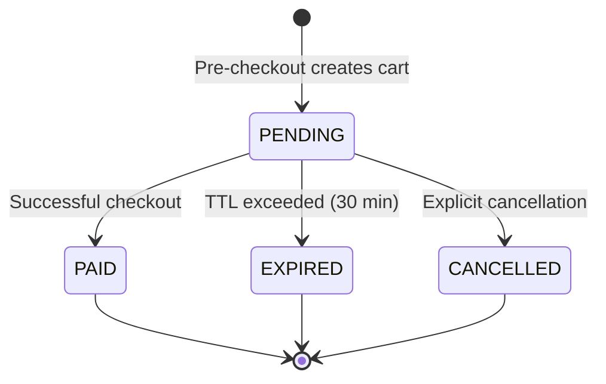

# Database Specification

**Status**: Confirmed  
**Version**: 1.0  
**Last Updated**: 2026-11-23  
**Owner**: Solution Architect / Technical Analyst

---

## 1. Overview

This document defines the database schema, entity relationships, and persistence strategy for the Checkout BFF. The database is PostgreSQL 16, managed via Flyway migrations.

---

## 2. Entity Relationship Diagram

```mermaid
erDiagram
    SHOPPING_CART ||--o{ CART_ITEM : contains
    SHOPPING_CART ||--|| PAYMENT_DATA : uses
    PAYMENT_DATA }|--|| PAYMENT_METHOD : "method"
    CART_ITEM }|--|| PRODUCT : references
    
    SHOPPING_CART {
        bigint id PK
        bigint payment_data_id FK
        numeric(10,2) price
        varchar(50) status
        timestamp paid_at
        timestamp created_at
    }
    
    CART_ITEM {
        bigint id PK
        bigint cart_id FK
        bigint product_id FK
        int quantity
    }
    
    PRODUCT {
        bigint id PK
        varchar(100) slug UK
        varchar(200) name
        text description
        numeric(10,2) price
        varchar(3) currency
        boolean active
    }
    
    PAYMENT_DATA {
        bigint id PK
        bigint method_id FK
        varchar(255) holder
        text details
    }
    
    PAYMENT_METHOD {
        bigint id PK
        varchar(100) name UK
        boolean active
    }
```

---

## 3. Table Definitions

### 3.1 shopping_cart

| Column | Type | Constraints | Description |
|--------|------|-------------|-------------|
| `id` | `BIGSERIAL` | `PRIMARY KEY` | Unique cart identifier |
| `payment_data_id` | `BIGINT` | `NOT NULL`, `UNIQUE`, `FK -> payment_data.id` | Reference to payment data |
| `price` | `NUMERIC(10,2)` | `NOT NULL` | Total cart price |
| `status` | `VARCHAR(50)` | `NOT NULL` | Cart status: PENDING, PAID, EXPIRED, CANCELLED |
| `paid_at` | `TIMESTAMP` | `NULL` | Timestamp when cart was paid |
| `created_at` | `TIMESTAMP` | `NOT NULL`, `DEFAULT now()` | Cart creation timestamp |

**Indexes**:
- `idx_shopping_cart_payment_data_id` (unique) on `payment_data_id`
- `idx_shopping_cart_status` on `status`
- `idx_shopping_cart_created_at` on `created_at`

### 3.2 cart_item

| Column | Type | Constraints | Description |
|--------|------|-------------|-------------|
| `id` | `BIGSERIAL` | `PRIMARY KEY` | Unique item identifier |
| `cart_id` | `BIGINT` | `NOT NULL`, `FK -> shopping_cart.id` | Reference to cart |
| `product_id` | `BIGINT` | `NOT NULL`, `FK -> product.id` | Reference to product |
| `quantity` | `INTEGER` | `NOT NULL`, `DEFAULT 1` | Item quantity |

**Indexes**:
- `idx_cart_item_cart_id` on `cart_id`
- `idx_cart_item_product_id` on `product_id`
- Unique constraint on `(cart_id, product_id)` - one item per product per cart

### 3.3 product

| Column | Type | Constraints | Description |
|--------|------|-------------|-------------|
| `id` | `BIGSERIAL` | `PRIMARY KEY` | Unique product identifier |
| `slug` | `VARCHAR(100)` | `NOT NULL`, `UNIQUE` | Product slug (e.g., 'basic') |
| `name` | `VARCHAR(200)` | `NOT NULL` | Display name |
| `description` | `TEXT` | `NULL` | Product description |
| `price` | `NUMERIC(10,2)` | `NOT NULL` | Price in currency |
| `currency` | `VARCHAR(3)` | `NOT NULL` | ISO 4217 code (BRL) |
| `active` | `BOOLEAN` | `NOT NULL`, `DEFAULT true` | Whether product is available |

**Indexes**:
- `idx_product_slug` (unique) on `slug`
- `idx_product_active` on `active`

**Initial Data**:
```sql
INSERT INTO product (slug, name, description, price, currency, active) VALUES
('basic', 'Basic', 'Basic subscription plan', 19.90, 'BRL', true),
('premium', 'Premium', 'Premium subscription plan', 39.90, 'BRL', true),
('family', 'Family', 'Family subscription plan', 59.90, 'BRL', true);
```

### 3.4 payment_method

| Column | Type | Constraints | Description |
|--------|------|-------------|-------------|
| `id` | `BIGSERIAL` | `PRIMARY KEY` | Unique payment method identifier |
| `name` | `VARCHAR(100)` | `NOT NULL`, `UNIQUE` | Method name (e.g., 'Cartão de Crédito') |
| `active` | `BOOLEAN` | `NOT NULL`, `DEFAULT true` | Whether method is available |

**Indexes**:
- `idx_payment_method_name` (unique) on `name`
- `idx_payment_method_active` on `active`

**Initial Data**:
```sql
INSERT INTO payment_method (name, active) VALUES
('Cartão de Crédito', true),
('Cartão de Débito', true),
('Pix', true);
```

### 3.5 payment_data

| Column | Type | Constraints | Description |
|--------|------|-------------|-------------|
| `id` | `BIGSERIAL` | `PRIMARY KEY` | Unique payment data identifier |
| `method_id` | `BIGINT` | `NOT NULL`, `FK -> payment_method.id` | Payment method used |
| `holder` | `VARCHAR(255)` | `NOT NULL` | Card/account holder name |
| `details` | `TEXT` | `NOT NULL` | Encrypted/tokenized payment details |

**Indexes**:
- `idx_payment_data_method_id` on `method_id`

---

## 4. Pre-Checkout Specific Persistence

### 4.1 Cart Creation During Pre-Checkout

When pre-checkout executes, the following are persisted atomically:

1. **ShoppingCart** record with:
   - `status = 'PENDING'`
   - `price = calculated total`
   - `payment_data_id` from request (or selected default)

2. **CartItem** records for each product:
   - `cart_id` = new cart ID
   - `product_id` = product ID from catalog
   - `quantity` = 1 (unique slugs per request per API contract)

3. **Product Snapshot** (implicit via cart_item -> product FK):
   - Product details at time of cart creation are preserved
   - Price, name, description captured via FK to product table

4. **Payment Methods Association**:
   - Available payment method IDs stored for validation at checkout
   - Could be separate table `cart_payment_method` (future) or derived from active methods

### 4.2 Cart Status Lifecycle



---

## 5. Flyway Migration Strategy

### 5.1 Migration Files

```
src/main/resources/db/migration/
├── V1__create_initial_schema.sql
├── V2__add_product_catalog.sql
├── V3__add_payment_methods.sql
├── V4__add_indexes.sql
└── V5__add_cart_status_check.sql
```

### 5.2 V1__create_initial_schema.sql

```sql
-- Enable UUID extension if needed
CREATE EXTENSION IF NOT EXISTS "uuid-ossp";

-- payment_method table
CREATE TABLE payment_method (
    id BIGSERIAL PRIMARY KEY,
    name VARCHAR(100) NOT NULL UNIQUE,
    active BOOLEAN NOT NULL DEFAULT true
);

-- product table
CREATE TABLE product (
    id BIGSERIAL PRIMARY KEY,
    slug VARCHAR(100) NOT NULL UNIQUE,
    name VARCHAR(200) NOT NULL,
    description TEXT,
    price NUMERIC(10,2) NOT NULL,
    currency VARCHAR(3) NOT NULL,
    active BOOLEAN NOT NULL DEFAULT true
);

-- payment_data table
CREATE TABLE payment_data (
    id BIGSERIAL PRIMARY KEY,
    method_id BIGINT NOT NULL REFERENCES payment_method(id),
    holder VARCHAR(255) NOT NULL,
    details TEXT NOT NULL
);

-- shopping_cart table
CREATE TABLE shopping_cart (
    id BIGSERIAL PRIMARY KEY,
    payment_data_id BIGINT NOT NULL UNIQUE REFERENCES payment_data(id),
    price NUMERIC(10,2) NOT NULL,
    status VARCHAR(50) NOT NULL,
    paid_at TIMESTAMP,
    created_at TIMESTAMP NOT NULL DEFAULT CURRENT_TIMESTAMP
);

-- cart_item table
CREATE TABLE cart_item (
    id BIGSERIAL PRIMARY KEY,
    cart_id BIGINT NOT NULL REFERENCES shopping_cart(id) ON DELETE CASCADE,
    product_id BIGINT NOT NULL REFERENCES product(id),
    quantity INTEGER NOT NULL DEFAULT 1,
    UNIQUE(cart_id, product_id)
);

-- Indexes
CREATE INDEX idx_shopping_cart_payment_data_id ON shopping_cart(payment_data_id);
CREATE INDEX idx_shopping_cart_status ON shopping_cart(status);
CREATE INDEX idx_shopping_cart_created_at ON shopping_cart(created_at);
CREATE INDEX idx_cart_item_cart_id ON cart_item(cart_id);
CREATE INDEX idx_cart_item_product_id ON cart_item(product_id);
CREATE INDEX idx_product_slug ON product(slug);
CREATE INDEX idx_product_active ON product(active);
CREATE INDEX idx_payment_method_name ON payment_method(name);
CREATE INDEX idx_payment_method_active ON payment_method(active);
CREATE INDEX idx_payment_data_method_id ON payment_data(method_id);
```

### 5.3 V2__add_product_catalog.sql

```sql
INSERT INTO product (slug, name, description, price, currency, active) VALUES
('basic', 'Basic', 'Basic subscription plan', 19.90, 'BRL', true),
('premium', 'Premium', 'Premium subscription plan', 39.90, 'BRL', true),
('family', 'Family', 'Family subscription plan', 59.90, 'BRL', true)
ON CONFLICT (slug) DO NOTHING;
```

### 5.4 V3__add_payment_methods.sql

```sql
INSERT INTO payment_method (name, active) VALUES
('Cartão de Crédito', true),
('Cartão de Débito', true),
('Pix', true)
ON CONFLICT (name) DO NOTHING;
```

### 5.5 V4__add_cart_status_check.sql

```sql
ALTER TABLE shopping_cart 
ADD CONSTRAINT chk_shopping_cart_status 
CHECK (status IN ('PENDING', 'PAID', 'EXPIRED', 'CANCELLED'));
```

---

## 6. JPA Entity Mapping

### 6.1 ShoppingCart Entity

```java
@Entity
@Table(name = "shopping_cart")
@Getter @Setter @Builder @NoArgsConstructor @AllArgsConstructor
public class ShoppingCart {
    @Id
    @GeneratedValue(strategy = GenerationType.IDENTITY)
    private Long id;

    @OneToOne(fetch = FetchType.LAZY)
    @JoinColumn(name = "payment_data_id", unique = true)
    private PaymentData paymentData;

    @Column(name = "price", nullable = false, precision = 10, scale = 2)
    private BigDecimal price;

    @Column(name = "status", nullable = false, length = 50)
    private String status;

    @Column(name = "paid_at")
    private LocalDateTime paidAt;

    @OneToMany(mappedBy = "shoppingCart", cascade = CascadeType.ALL, orphanRemoval = true)
    @Builder.Default
    private List<CartItem> items = new ArrayList<>();

    @CreationTimestamp
    @Column(name = "created_at", updatable = false)
    private LocalDateTime createdAt;
}
```

### 6.2 CartItem Entity

```java
@Entity
@Table(name = "cart_item", uniqueConstraints = @UniqueConstraint(columnNames = {"cart_id", "product_id"}))
@Getter @Setter @Builder @NoArgsConstructor @AllArgsConstructor
public class CartItem {
    @Id
    @GeneratedValue(strategy = GenerationType.IDENTITY)
    private Long id;

    @Column(name = "quantity", nullable = false)
    @Builder.Default
    private Integer quantity = 1;

    @ManyToOne(fetch = FetchType.LAZY)
    @JoinColumn(name = "cart_id", nullable = false)
    private ShoppingCart shoppingCart;

    @ManyToOne(fetch = FetchType.LAZY)
    @JoinColumn(name = "product_id", nullable = false)
    private Product product;
}
```

### 6.3 Product Entity

```java
@Entity
@Table(name = "product")
@Getter @Setter @Builder @NoArgsConstructor @AllArgsConstructor
public class Product {
    @Id
    @GeneratedValue(strategy = GenerationType.IDENTITY)
    private Long id;

    @Column(name = "slug", nullable = false, unique = true, length = 100)
    private String slug;

    @Column(name = "name", nullable = false, length = 200)
    private String name;

    @Column(name = "description", columnDefinition = "TEXT")
    private String description;

    @Column(name = "price", nullable = false, precision = 10, scale = 2)
    private BigDecimal price;

    @Column(name = "currency", nullable = false, length = 3)
    private String currency;

    @Column(name = "active", nullable = false)
    private Boolean active = true;
}
```

### 6.4 PaymentMethod Entity

```java
@Entity
@Table(name = "payment_method")
@Getter @Setter @Builder @NoArgsConstructor @AllArgsConstructor
public class PaymentMethod {
    @Id
    @GeneratedValue(strategy = GenerationType.IDENTITY)
    private Long id;

    @Column(name = "name", nullable = false, unique = true)
    private String name;

    @Column(name = "active", nullable = false)
    private Boolean active = true;
}
```

---

## 7. Repository Queries

### 7.1 ProductRepository (JPA)

```java
@Repository
public interface ProductJpaRepository extends JpaRepository<Product, Long> {
    Optional<Product> findBySlug(String slug);
    List<Product> findByActiveTrue();
    
    @Query("SELECT p FROM Product p WHERE p.slug IN :slugs AND p.active = true")
    List<Product> findBySlugInAndActiveTrue(@Param("slugs") List<String> slugs);
}
```

### 7.2 PaymentMethodRepository (JPA)

```java
@Repository
public interface PaymentMethodJpaRepository extends JpaRepository<PaymentMethod, Long> {
    Optional<PaymentMethod> findByName(String name);
    List<PaymentMethod> findByActiveTrue();
}
```

### 7.3 ShoppingCartRepository (JPA)

```java
@Repository
public interface ShoppingCartJpaRepository extends JpaRepository<ShoppingCart, Long> {
    
    @EntityGraph(attributePaths = {"items", "items.product", "paymentData", "paymentData.paymentMethod"})
    Optional<ShoppingCart> findByIdWithItems(Long id);
    
    @Query("SELECT c FROM ShoppingCart c WHERE c.paymentData.id = :paymentDataId")
    Optional<ShoppingCart> findByPaymentDataId(Long paymentDataId);
    
    @Query("SELECT c FROM ShoppingCart c WHERE c.status = 'PENDING' AND c.createdAt < :expiryThreshold")
    List<ShoppingCart> findExpiredPendingCarts(@Param("expiryThreshold") LocalDateTime expiryThreshold);
}
```

---

## 8. Transaction Boundaries

| Operation | Transaction Scope | Isolation | Propagation |
|-----------|-------------------|-----------|-------------|
| Pre-Checkout (create cart) | Single transaction | READ_COMMITTED | REQUIRED |
| Get Cart | Read-only | READ_COMMITTED | SUPPORTS |
| Add Cart Item | Single transaction | READ_COMMITTED | REQUIRED |
| Checkout (sync) | Single transaction | READ_COMMITTED | REQUIRED |
| Checkout (async init) | Single transaction | READ_COMMITTED | REQUIRED |

---

## 9. Data Retention & Archival

| Entity | Retention Policy | Archival Strategy |
|--------|------------------|-------------------|
| ShoppingCart (PAID) | 7 years (compliance) | Partition by year |
| ShoppingCart (EXPIRED/CANCELLED) | 90 days | Soft delete + purge job |
| CartItem | Same as parent cart | Cascade with cart |
| Product | Permanent | Never deleted, only deactivated |
| PaymentMethod | Permanent | Never deleted, only deactivated |
| PaymentData | 7 years (compliance) | Encrypted archive |

---

## 10. Traceability

| Database Element | Functional Requirement | Technical Spec |
|------------------|------------------------|----------------|
| shopping_cart table | FR-PRE-001, BR-PRE-002, BR-PRE-004 | AC-PRE-007 |
| cart_item table | FR-PRE-001, BR-PRE-002 | AC-PRE-001, AC-PRE-007 |
| product table | FR-PRE-002 | AC-PRE-001, AC-PRE-002, AC-PRE-003 |
| payment_method table | FR-PRE-003 | AC-PRE-006 |
| payment_data table | FR-PRE-001 (indirect) | Related to checkout |
| V1 migration | All | Schema creation |
| V2 migration | FR-PRE-002 | Product catalog |
| V3 migration | FR-PRE-003 | Payment methods catalog |