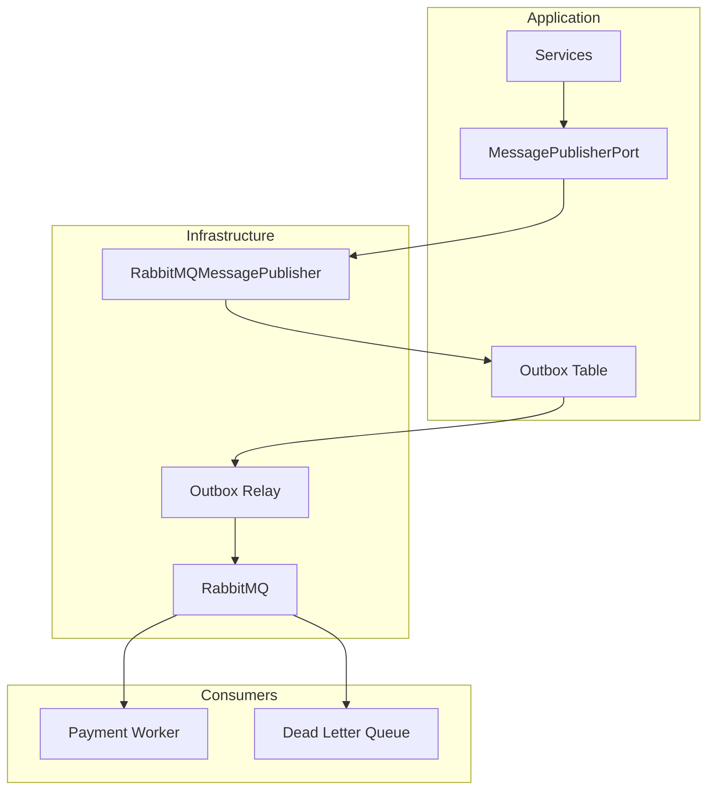
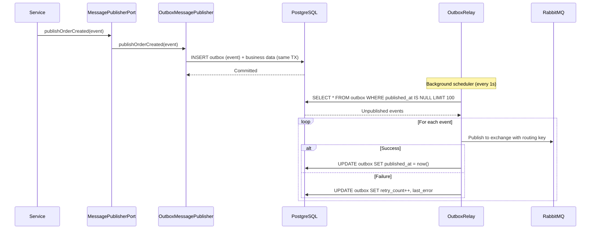

# Messaging Specification

**Status**: Confirmed  
**Version**: 1.0  
**Last Updated**: 2026-11-23  
**Owner**: Solution Architect

---

## 1. Overview

This document defines the asynchronous messaging architecture for the Checkout BFF using RabbitMQ. It covers event publication, message consumption, consumer idempotency, retry handling, dead-letter queues, and the transactional outbox pattern.

---

## 2. Messaging Architecture



---

## 3. RabbitMQ Topology

### 3.1 Exchanges

| Exchange | Type | Durable | Description |
|----------|------|---------|-------------|
| `checkout.exchange` | Topic | Yes | Main exchange for checkout events |
| `checkout.dlx` | Topic | Yes | Dead letter exchange |

### 3.2 Queues

| Queue | Durable | Description |
|-------|---------|-------------|
| `checkout.payment.request` | Yes | Payment processing requests |
| `checkout.payment.request.dlq` | Yes | Failed payment messages |
| `checkout.cart.updated` | Yes | Cart update notifications |
| `checkout.order.created` | Yes | Order creation events |

### 3.3 Bindings

| Queue | Exchange | Routing Key |
|-------|----------|-------------|
| `checkout.payment.request` | `checkout.exchange` | `payment.request` |
| `checkout.cart.updated` | `checkout.exchange` | `cart.updated` |
| `checkout.order.created` | `checkout.exchange` | `order.created` |
| `checkout.payment.request.dlq` | `checkout.dlx` | `payment.request` |

### 3.4 Queue Configuration

```yaml
spring:
  rabbitmq:
    host: ${RABBITMQ_HOST:localhost}
    port: ${RABBITMQ_PORT:5672}
    username: ${RABBITMQ_USER:guest}
    password: ${RABBITMQ_PASSWORD:guest}
    listener:
      simple:
        concurrency: 3
        max-concurrency: 10
        prefetch: 10
        default-requeue-rejected: false
        retry:
          enabled: true
          max-attempts: 3
          initial-interval: 5000
          multiplier: 2.0
          max-interval: 60000
```

---

## 4. Event Definitions

### 4.1 CartUpdatedEvent

Published when a cart is created or modified.

```java
public record CartUpdatedEvent(
    String eventId,           // UUID
    String eventType,         // "CART_UPDATED"
    Long cartId,
    String cartStatus,        // PENDING, PAID, EXPIRED, CANCELLED
    BigDecimal totalAmount,
    String currency,
    List<CartItemEvent> items,
    Instant timestamp,
    String correlationId
) {}

public record CartItemEvent(
    Long productId,
    String productSlug,
    String productName,
    BigDecimal unitPrice,
    Integer quantity
) {}
```

**Routing Key**: `cart.updated`  
**Queue**: `checkout.cart.updated`

### 4.2 OrderCreatedEvent

Published when a checkout is initiated (sync or async).

```java
public record OrderCreatedEvent(
    String eventId,
    String eventType,         // "ORDER_CREATED"
    String cartId,            // UUID
    String checkoutId,        // UUID for async checkout
    Long paymentMethodId,
    String paymentMethodName,
    BigDecimal amount,
    String currency,
    PaymentDetailsEvent paymentDetails,
    PixPayerEvent pixPayer,   // PIX payer info (name and CPF) - only for PIX
    Instant timestamp,
    String correlationId
) {}

public record PaymentDetailsEvent(
    String type,              // "CREDIT_CARD", "DEBIT_CARD", "PIX"
    String maskedData         // Last 4 digits for card / pix-{checkoutId} for PIX
) {}

public record PixPayerEvent(
    String name,              // Payer full name
    String cpf                // Payer CPF (validated 11-digit format)
) {}
```

**Routing Key**: `order.created`  
**Queue**: `checkout.order.created`

### 4.3 PaymentProcessedEvent

Published when payment processing completes (async flow).

```java
public record PaymentProcessedEvent(
    String eventId,
    String eventType,         // "PAYMENT_PROCESSED"
    String checkoutId,
    Long cartId,
    String status,            // APPROVED, DECLINED, FAILED
    String paymentMethodName,
    BigDecimal amount,
    String currency,
    PaymentResultEvent result,
    Instant timestamp,
    String correlationId
) {}

public record PaymentResultEvent(
    String authorizationCode,
    String maskedCardNumber,  // Last 4 digits only
    String pixCode,
    String failureReason
) {}
```

**Routing Key**: `payment.processed`  
**Queue**: `checkout.payment.request` (for async processing)

---

## 5. Message Publisher Port

```java
public interface MessagePublisherPort {
    void publishCartUpdated(CartUpdatedEvent event);
    void publishOrderCreated(OrderCreatedEvent event);
    void publishPaymentProcessed(PaymentProcessedEvent event);
}
```

---

## 6. Transactional Outbox Pattern

### 6.1 Outbox Table

```sql
CREATE TABLE outbox (
    id BIGSERIAL PRIMARY KEY,
    event_id VARCHAR(36) NOT NULL UNIQUE,
    event_type VARCHAR(100) NOT NULL,
    payload JSONB NOT NULL,
    routing_key VARCHAR(200) NOT NULL,
    exchange VARCHAR(100) NOT NULL DEFAULT 'checkout.exchange',
    created_at TIMESTAMP NOT NULL DEFAULT CURRENT_TIMESTAMP,
    published_at TIMESTAMP,
    retry_count INT NOT NULL DEFAULT 0,
    last_error TEXT
);

CREATE INDEX idx_outbox_unpublished ON outbox(published_at) WHERE published_at IS NULL;
CREATE INDEX idx_outbox_created_at ON outbox(created_at);
```

### 6.2 Outbox Entity

```java
@Entity
@Table(name = "outbox")
@Getter @Setter @Builder @NoArgsConstructor @AllArgsConstructor
public class OutboxEvent {
    @Id
    @GeneratedValue(strategy = GenerationType.IDENTITY)
    private Long id;

    @Column(name = "event_id", nullable = false, unique = true, length = 36)
    private String eventId;

    @Column(name = "event_type", nullable = false, length = 100)
    private String eventType;

    @Column(name = "payload", nullable = false, columnDefinition = "JSONB")
    private String payload;

    @Column(name = "routing_key", nullable = false, length = 200)
    private String routingKey;

    @Column(name = "exchange", nullable = false, length = 100)
    private String exchange = "checkout.exchange";

    @Column(name = "created_at", nullable = false, updatable = false)
    private LocalDateTime createdAt;

    @Column(name = "published_at")
    private LocalDateTime publishedAt;

    @Column(name = "retry_count", nullable = false)
    @Builder.Default
    private Integer retryCount = 0;

    @Column(name = "last_error", columnDefinition = "TEXT")
    private String lastError;
}
```

### 6.3 Outbox Repository

```java
public interface OutboxRepository extends JpaRepository<OutboxEvent, Long> {
    List<OutboxEvent> findByPublishedAtIsNullOrderByCreatedAtAsc(int limit);
    
    @Modifying
    @Query("UPDATE OutboxEvent o SET o.publishedAt = :now, o.retryCount = o.retryCount + 1, o.lastError = :error WHERE o.id = :id")
    void markAsFailed(@Param("id") Long id, @Param("now") LocalDateTime now, @Param("error") String error);
    
    @Modifying
    @Query("UPDATE OutboxEvent o SET o.publishedAt = :now WHERE o.id = :id")
    void markAsPublished(@Param("id") Long id, @Param("now") LocalDateTime now);
}
```

### 6.4 Outbox Publisher Flow



### 6.5 Outbox Relay Configuration

```yaml
outbox:
  relay:
    enabled: true
    poll-interval-ms: 1000
    batch-size: 100
    max-retries: 5
    retry-delay-ms: 5000
```

---

## 7. Consumer Implementation

### 7.1 Payment Worker Consumer

```java
@Component
@RequiredArgsConstructor
public class PaymentRequestConsumer {
    
    private final ProcessPaymentUseCase processPaymentUseCase;
    private final ObjectMapper objectMapper;
    
    @RabbitListener(queues = "checkout.payment.request")
    public void consume(Message message, Channel channel) throws IOException {
        long deliveryTag = message.getMessageProperties().getDeliveryTag();
        
        try {
            var event = objectMapper.readValue(message.getBody(), PaymentProcessedEvent.class);
            
            // Idempotency check
            if (processPaymentUseCase.isAlreadyProcessed(event.checkoutId())) {
                log.info("Duplicate payment request for checkoutId: {}", event.checkoutId());
                channel.basicAck(deliveryTag, false);
                return;
            }
            
            processPaymentUseCase.execute(event);
            channel.basicAck(deliveryTag, false);
            
        } catch (Exception ex) {
            log.error("Failed to process payment request", ex);
            
            // Check retry count from headers
            Integer retryCount = (Integer) message.getMessageProperties().getHeaders().get("x-retry-count");
            retryCount = retryCount != null ? retryCount + 1 : 1;
            
            if (retryCount >= 3) {
                // Send to DLQ
                channel.basicReject(deliveryTag, false);
            } else {
                // Requeue with delay
                requeueWithDelay(channel, message, deliveryTag, retryCount);
            }
        }
    }
    
    private void requeueWithDelay(Channel channel, Message message, long deliveryTag, int retryCount) 
            throws IOException {
        // Publish to delay exchange or use TTL
        // Implementation depends on RabbitMQ delayed message plugin
    }
}
```

### 7.2 Consumer Idempotency

Each consumer must implement idempotency using a processed event store:

```java
public interface ProcessedEventStore {
    boolean isProcessed(String eventId);
    void markProcessed(String eventId, String checkoutId);
}

@Component
public class ProcessedEventStoreImpl implements ProcessedEventStore {
    
    private final RedisTemplate<String, String> redisTemplate;
    private static final String PREFIX = "processed:event:";
    private static final Duration TTL = Duration.ofDays(7);
    
    @Override
    public boolean isProcessed(String eventId) {
        return Boolean.TRUE.equals(redisTemplate.hasKey(PREFIX + eventId));
    }
    
    @Override
    public void markProcessed(String eventId, String checkoutId) {
        redisTemplate.opsForValue().set(PREFIX + eventId, checkoutId, TTL);
    }
}
```

---

## 8. Dead Letter Queue (DLQ) Handling

### 8.1 DLQ Configuration

```java
@Configuration
public class RabbitMQConfig {
    
    @Bean
    public Queue paymentRequestQueue() {
        return QueueBuilder.durable("checkout.payment.request")
            .withArgument("x-dead-letter-exchange", "checkout.dlx")
            .withArgument("x-dead-letter-routing-key", "payment.request")
            .build();
    }
    
    @Bean
    public Queue paymentRequestDLQ() {
        return QueueBuilder.durable("checkout.payment.request.dlq").build();
    }
    
    @Bean
    public TopicExchange deadLetterExchange() {
        return ExchangeBuilder.topicExchange("checkout.dlx").durable(true).build();
    }
    
    @Bean
    public Binding dlqBinding() {
        return BindingBuilder.bind(paymentRequestDLQ())
            .to(deadLetterExchange())
            .with("payment.request");
    }
}
```

### 8.2 DLQ Consumer (Monitoring/Alerting)

```java
@Component
@RequiredArgsConstructor
public class DLQMonitor {
    
    private final AlertService alertService;
    
    @RabbitListener(queues = "checkout.payment.request.dlq")
    public void monitorDLQ(Message message) {
        log.warn("Message in DLQ: {}", new String(message.getBody()));
        
        // Alert on-call team
        alertService.sendAlert("Payment message in DLQ", 
            Map.of("payload", new String(message.getBody())));
    }
}
```

---

## 9. Retry Strategy

| Attempt | Delay | Backoff |
|---------|-------|---------|
| 1 | 5 seconds | Initial |
| 2 | 10 seconds | 2x |
| 3 | 20 seconds | 2x |
| 4+ | Move to DLQ | - |

**Max Retries**: 3 (configurable)  
**Retryable Errors**: Transient failures (network, timeout, temporary unavailability)  
**Non-Retryable Errors**: Validation errors, business rule violations, duplicate detection

---

## 10. Correlation ID Propagation

All messages must carry correlation ID for distributed tracing:

```java
public class CorrelationIdMessagePostProcessor implements MessagePostProcessor {
    
    @Override
    public Message postProcessMessage(Message message) {
        String correlationId = MDC.get("correlationId");
        if (correlationId != null) {
            message.getMessageProperties().setHeader("X-Correlation-ID", correlationId);
        }
        return message;
    }
}
```

---

## 11. Security Considerations

| Concern | Mitigation |
|---------|------------|
| Sensitive data in messages | Never include full card numbers, CVV, tokens in events |
| Message tampering | RabbitMQ TLS in production |
| Unauthorized access | RabbitMQ authentication + authorization |
| PII in DLQ | Mask/encrypt sensitive fields before DLQ |

**Masking Example**:
```java
// In PaymentProcessedEvent
String maskedCardNumber = cardNumber.length() > 4 
    ? "****" + cardNumber.substring(cardNumber.length() - 4)
    : "****";
```

---

## 12. Observability

### 12.1 Metrics

| Metric | Description |
|--------|-------------|
| `rabbitmq.messages.published` | Messages published to exchange |
| `rabbitmq.messages.consumed` | Messages successfully consumed |
| `rabbitmq.messages.requeued` | Messages requeued for retry |
| `rabbitmq.messages.dlq` | Messages sent to DLQ |
| `rabbitmq.consumer.lag` | Queue depth per consumer |
| `outbox.events.pending` | Unpublished outbox events |
| `outbox.events.published` | Successfully published outbox events |

### 12.2 Health Checks

```yaml
management:
  health:
    rabbit:
      enabled: true
```

---

## 13. Traceability

| Messaging Element | Functional Requirement | Technical Spec |
|-------------------|------------------------|----------------|
| CartUpdatedEvent | FR-PRE-001 (notification) | Architecture §4 |
| OrderCreatedEvent | FR-PRE-001 (checkout trigger) | Architecture §4 |
| PaymentProcessedEvent | Async checkout (extension) | Scope §2.3 |
| Transactional Outbox | NFR: Reliability | Scope §2.7 |
| RabbitMQ Topology | NFR: Reliability | This doc §3 |
| Consumer Idempotency | NFR: Reliability | Scope §2.7 |
| DLQ | NFR: Reliability | Scope §2.7 |
| Retry Strategy | NFR: Reliability | Scope §2.7 |
| Correlation ID | NFR: Observability | This doc §10 |